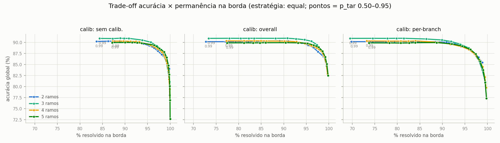

# TCC — DNN com Saídas Antecipadas para Inferência Híbrida Edge/Cloud

MobileNetV2 com **saídas antecipadas (early exits)** treinada em **CIFAR-10**, avaliada
em uma **cascata edge→cloud**: cada amostra é classificada no ramo mais raso cuja
confiança atinge um limiar `p_tar`; amostras em que nenhum ramo é confiante o
suficiente são encaminhadas à saída final (a "nuvem"). O objetivo é maximizar a
fração de amostras resolvida na borda mantendo a acurácia global.

```
imagem ─► [stage 1] ─► ramo 1 ─ conf ≥ p_tar? ─ sim ─► classe   ┐
              │                     não                          │ borda (edge)
              ▼                                                  │
          [stage 2] ─► ramo 2 ─ conf ≥ p_tar? ─ sim ─► classe   ┘
              │                     não
              ▼
          [stage final] ─► saída final ─► classe                 ─ nuvem (cloud)
```

---

## 1. Modelo

| Parâmetro | Valor |
|---|---|
| Backbone | **MobileNetV2** (`torchvision`), pesos pré-treinados **ImageNet** (`IMAGENET1K_V1`) |
| Nº de ramos antecipados | **2 a 5** (paramétrico, `N_BRANCHES`) |
| Posicionamento dos ramos | Linear em **FLOPs cumulativos** (perfilados com `thop`) |
| Classes | 10 (CIFAR-10) |
| Entrada | 32×32×3 |

### Adaptação para CIFAR-10 (32×32)

A MobileNetV2 original é desenhada para entradas 224×224. Para não destruir a
resolução espacial de imagens 32×32, o **primeiro conv tem o stride reduzido de
2 para 1** (`3×3, padding=1`); esse conv perde os pesos pré-treinados (é
reinicializado), mas todas as demais camadas mantêm os pesos ImageNet.

### Arquitetura dos exit heads

Cada ramo antecipado é um classificador leve acoplado à saída de um bloco
intermediário do backbone:

```
AdaptiveAvgPool2d(1×1) → Flatten → Linear(C → 128) → ReLU → Dropout(0.5) → Linear(128 → 10)
```

onde `C` é o nº de canais do bloco em que o ramo é inserido (inferido
automaticamente via dummy forward). A saída final usa o pooling global padrão da
MobileNetV2 seguido de `Linear(1280 → 10)`.

### Posicionamento por FLOPs

Os FLOPs de cada um dos 19 blocos de `features[]` são medidos com `thop.profile`
e acumulados; os N ramos são colocados nos blocos que primeiro atingem as frações
`i/(N+1)` do custo total — ou seja, espaçados por **esforço computacional**, não
por contagem de camadas. Posições resultantes (índices em `features[]`):

| Modelo | Posições dos ramos |
|---|---|
| b2 | 5, 13 |
| b3 | 3, 10, 14 |
| b4 | 3, 6, 12, 15 |
| b5 | 2, 5, 10, 13, 16 |

## 2. Dados e treinamento

| Hiperparâmetro | Valor |
|---|---|
| Dataset | CIFAR-10 (50k treino / 10k teste) |
| Split treino/val | 80/20, `SEED=42` (reproduzível; o mesmo split é usado na calibração) |
| Augmentation | `RandomCrop(32, pad=4)` + `RandomHorizontalFlip`; normalização (0.5, 0.5) |
| Loss | Soma ponderada de `CrossEntropyLoss` sobre todas as saídas |
| Fase 1 — warmup | 5 épocas, backbone congelado (treina só heads + 1º conv), Adam `lr=1e-3` |
| Fase 2 — fine-tuning | Rede inteira, Adam `lr=1e-4` |
| Early stopping | Paciência 30 sobre a val loss, máx. 150 épocas |
| Batch size | 128 |
| Checkpoint | Melhor val loss; salva `state_dict` + metadados (`exit_positions`, etc.) |

### Estratégias de peso da loss

Cada estratégia gera um treino independente (`LOSS_WEIGHTS_LIST`):

- **`equal`** — todas as saídas com peso 1.0;
- **`linspace`** — pesos crescentes de 0.15 (ramo mais raso) a 1.0 (saída final),
  o esquema clássico tipo BranchyNet;
- também suportados: `inv_linspace` e pesos manuais via CSV.

### Acurácia por saída (test set, ao fim do treino)

| Modelo | Estratégia | Ramo 1 | Ramo 2 | Ramo 3 | Ramo 4 | Ramo 5 | Final |
|---|---|---|---|---|---|---|---|
| b2 | equal | 75.6 | 89.7 | — | — | — | 89.8 |
| b2 | linspace | 60.3 | 89.3 | — | — | — | 90.0 |
| b3 | equal | 64.0 | 89.0 | 90.6 | — | — | 90.6 |
| b3 | linspace | 49.3 | 86.2 | 89.9 | — | — | 89.7 |
| b4 | equal | 65.4 | 82.4 | 89.8 | 90.8 | — | 90.5 |
| b4 | linspace | 52.6 | 74.3 | 89.4 | 90.4 | — | 90.3 |
| b5 | equal | 51.0 | 76.3 | 89.1 | 90.8 | 90.9 | 90.6 |
| b5 | linspace | 41.2 | 64.9 | 86.0 | 89.3 | 89.5 | 89.2 |

O padrão é consistente: `linspace` sacrifica fortemente os ramos rasos (até −14 pp
no ramo 1) sem ganho relevante na saída final — o que compromete o propósito do
sistema de borda.

## 3. Calibração — Temperature Scaling

Redes neurais tendem a ser *overconfident*, e a decisão da cascata depende da
confiança ser honesta. Seguindo Guo et al. (2017), uma temperatura `T` divide os
logits antes do softmax (`softmax(z/T)`), otimizada por **LBFGS** (init `T=1.5`,
`lr=0.01`, 50 iterações) para minimizar a NLL no **conjunto de validação** (nunca
visto no treino). Duas variantes:

- **`overall`** — uma única `T` para todas as saídas;
- **`branches`** (per-branch) — uma `T_i` por saída.

Temperaturas obtidas (salvas dentro do próprio checkpoint):

| Modelo | Estratégia | T per-branch (rasa → final) | T overall |
|---|---|---|---|
| b2 | equal | 1.24, 1.61, 1.71 | 1.50 |
| b2 | linspace | 1.16, 1.42, 1.62 | 1.37 |
| b3 | equal | 1.16, 1.52, 1.70, 1.74 | 1.51 |
| b3 | linspace | 1.15, 1.29, 1.50, 1.63 | 1.38 |
| b4 | equal | 1.18, 1.30, 1.67, 1.75, 1.75 | 1.51 |
| b4 | linspace | 1.17, 1.22, 1.48, 1.66, 1.70 | 1.42 |
| b5 | equal | 1.19, 1.26, 1.53, 1.69, 1.74, 1.75 | 1.51 |
| b5 | linspace | 1.20, 1.18, 1.32, 1.49, 1.63, 1.67 | 1.41 |

Em todos os modelos **T cresce com a profundidade da saída**: as saídas profundas
são as mais overconfident.

## 4. Protocolo de avaliação (cascata)

- **Test set completo** (10k amostras), batch inference com coleta dos logits de
  todas as saídas.
- **Limiar `p_tar` varrido de 0.50 a 0.95 em passos de 0.05** (10 pontos).
- **3 modos de calibração**: `none` (logits crus), `overall`, `branches`.
- Regra: a amostra sai na **primeira saída com confiança ≥ `p_tar`**; senão, na final.
- **Borda vs nuvem**: os N ramos contam como borda; a saída final como nuvem.
- **Variância**: cada acurácia é acompanhada da meia-largura do **IC95% binomial**
  (`1.96·√(p(1−p)/n)`). Saídas que recebem poucas amostras têm intervalos largos —
  a "acurácia da nuvem" baixa (40–60%) é **viés de seleção** (ela só recebe as
  amostras mais difíceis), não defeito do modelo.

Total: 4 modelos × 2 estratégias × 3 calibrações × 10 limiares = **240 pontos de
operação** (24 CSVs em [results/](results/)).

## 5. Resultados

### Acurácia global × limiar


### Fração resolvida na borda × limiar


### O trade-off central: acurácia × permanência na borda

Cada ponto é um `p_tar`; curvas mais próximas do canto superior direito são
melhores (mais acurácia **e** mais borda):



### Efeito da calibração


### Onde cada amostra é decidida


### Tabela-resumo (estratégia `equal`, test set)

Acurácia global ± IC95%, fração na borda e na nuvem:

| Ramos | Calib | p_tar=0.70 | borda/nuvem | p_tar=0.80 | borda/nuvem | p_tar=0.90 | borda/nuvem |
|---|---|---|---|---|---|---|---|
| 2 | none | 86.81 ± 0.66 | 95.5 / 4.5 | 88.51 ± 0.63 | 92.5 / 7.5 | 89.51 ± 0.60 | 87.3 / 12.7 |
| 2 | overall | 89.11 ± 0.61 | 91.1 / 8.9 | 89.67 ± 0.60 | 86.1 / 13.9 | 89.84 ± 0.59 | 79.2 / 20.8 |
| 2 | branches | 88.20 ± 0.63 | 91.2 / 8.8 | 89.27 ± 0.61 | 85.8 / 14.2 | 89.73 ± 0.59 | 77.9 / 22.1 |
| 3 | none | 87.17 ± 0.66 | 98.2 / 1.8 | 89.29 ± 0.61 | 96.2 / 3.8 | 90.29 ± 0.58 | 93.0 / 7.0 |
| 3 | overall | 89.87 ± 0.59 | 95.4 / 4.6 | 90.49 ± 0.57 | 92.0 / 8.0 | 90.65 ± 0.57 | 86.4 / 13.6 |
| 3 | branches | 88.69 ± 0.62 | 95.0 / 5.0 | 89.90 ± 0.59 | 91.3 / 8.7 | 90.57 ± 0.57 | 84.6 / 15.4 |
| 4 | none | 85.39 ± 0.69 | 99.3 / 0.7 | 88.19 ± 0.63 | 97.8 / 2.2 | 89.72 ± 0.60 | 94.9 / 5.1 |
| 4 | overall | 89.17 ± 0.61 | 97.0 / 3.0 | 90.05 ± 0.59 | 93.8 / 6.2 | 90.57 ± 0.57 | 89.1 / 10.9 |
| 4 | branches | 87.73 ± 0.64 | 96.5 / 3.5 | 89.42 ± 0.60 | 93.0 / 7.0 | 90.27 ± 0.58 | 87.5 / 12.6 |
| 5 | none | 85.31 ± 0.69 | 99.5 / 0.5 | 88.74 ± 0.62 | 98.5 / 1.4 | 90.11 ± 0.59 | 96.3 / 3.7 |
| 5 | overall | 89.50 ± 0.60 | 98.0 / 2.0 | 90.44 ± 0.58 | 95.4 / 4.6 | **90.75 ± 0.57** | 90.6 / 9.4 |
| 5 | branches | 88.25 ± 0.63 | 97.6 / 2.4 | 89.97 ± 0.59 | 94.5 / 5.5 | 90.61 ± 0.57 | 89.0 / 11.1 |

(Tabela completa, incluindo `linspace` e acurácia por saída individual, nos CSVs
de [results/](results/).)

### Principais achados

1. **`equal` > `linspace`.** Pesos iguais na loss produzem ramos rasos muito mais
   competentes; `linspace` reduz drasticamente a fração resolvida na borda sem
   ganho de acurácia global correspondente.
2. **Calibração melhora a acurácia global em todo o intervalo de `p_tar`**, com
   ganho maior em limiares baixos (até ~4 pp em `p_tar=0.50–0.70` nos modelos
   maiores) — e `overall` supera `branches` consistentemente, apesar de ter menos
   parâmetros (1 vs N+1). Hipótese: as temperaturas per-branch sobreajustam o
   conjunto de validação.
3. **Calibração troca volume de borda por qualidade de decisão.** Com `T>1` as
   confianças encolhem, menos amostras passam o limiar na borda (ex.: b5 em
   `p_tar=0.80`: 98.5% → 95.4% na borda), mas as decisões tomadas na borda ficam
   mais certeiras (89.5% → 92.8% de acurácia na borda).
4. **Mais ramos dominam o trade-off.** No plano acurácia × fração-na-borda, as
   curvas de 3–5 ramos ficam acima da de 2 ramos: para a mesma acurácia global,
   mais ramos mantêm mais amostras na borda. O melhor ponto de operação observado
   é **b5 + `overall` em `p_tar=0.90`: 90.75% ± 0.57 de acurácia com 90.6% das
   amostras resolvidas na borda**.
5. **A acurácia por saída não é monotônica na cascata**: a "nuvem" exibe acurácia
   de 40–60% porque recebe apenas as amostras que nenhum ramo resolveu — as
   intrinsecamente difíceis (viés de seleção, esperado e documentado nos IC95%).

## 6. Estrutura do repositório

```
src/
  model.py       # MobileNetV2EarlyExit paramétrico + posicionamento por FLOPs
  train.py       # treino em 2 fases (warmup + fine-tuning), multi-estratégia
  calibrate.py   # temperature scaling (overall + per-branch), LBFGS
  inference.py   # cascata edge→cloud: varredura de p_tar × calibração → CSVs
  plots.py       # figuras a partir dos CSVs de results/
  evaluate.py    # (legado, 2 ramos fixos) FLOPs/latência por saída
saved_model/     # checkpoints .pth (pesos + posições + temperaturas)
results/         # CSVs da cascata (1 por modelo × calibração)
plots/           # figuras geradas
logs/            # logs de treino e dos pipelines
data/            # CIFAR-10 (download automático)
fontes/          # papers de referência (BranchyNet, temperature scaling, etc.)
run_experiments.sh  # pipeline completo: treino → calibração → inferência
```

## 7. Como reproduzir

Requer [uv](https://docs.astral.sh/uv/) e uma GPU CUDA (opcional — cai para CPU).

```bash
uv sync
uv pip install -r requirements.txt

# pipeline completo (treino + calibração + inferência) para todos os tamanhos:
./run_experiments.sh

# ou por etapa, controlando via env vars:
N_BRANCHES=3 LOSS_WEIGHTS_LIST=equal uv run python -m src.train
N_BRANCHES=3 uv run python -m src.calibrate
N_BRANCHES=3 uv run python -m src.inference
uv run python -m src.plots
```

## Referências principais

- Teerapittayanon et al., *BranchyNet: Fast Inference via Early Exiting from Deep Neural Networks* (2016)
- Guo et al., *On Calibration of Modern Neural Networks* (2017)
- Sandler et al., *MobileNetV2: Inverted Residuals and Linear Bottlenecks* (2018)
- PDFs em [fontes/](fontes/)
