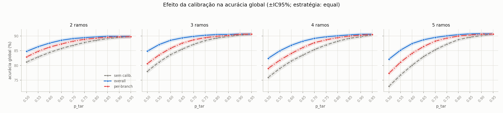
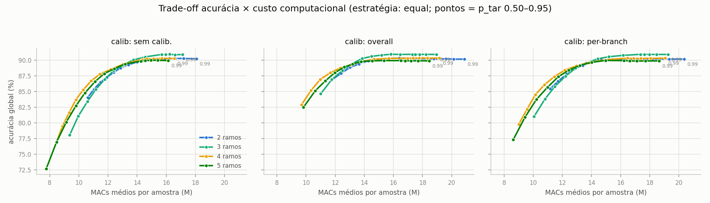
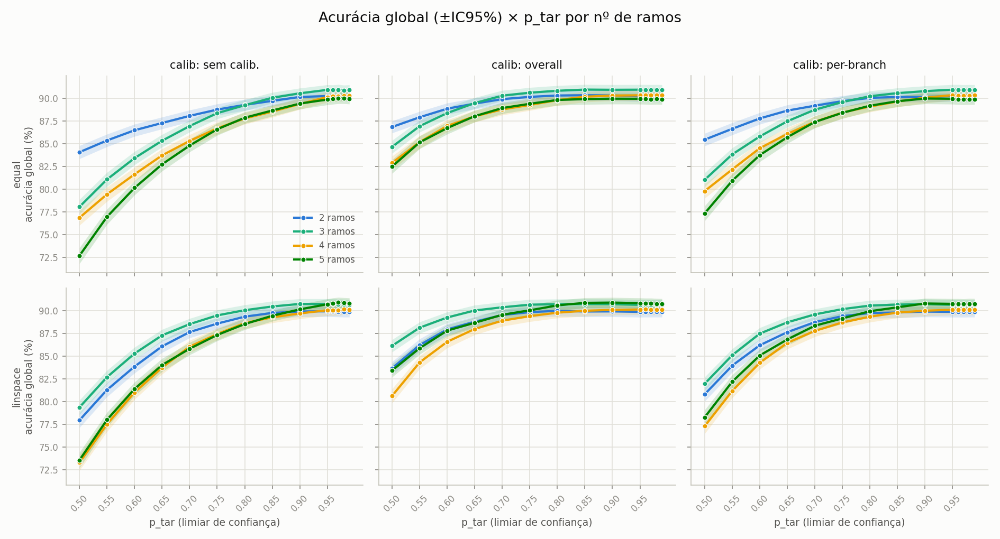
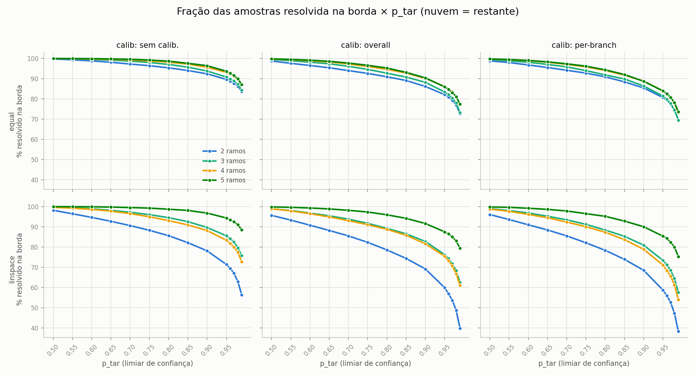
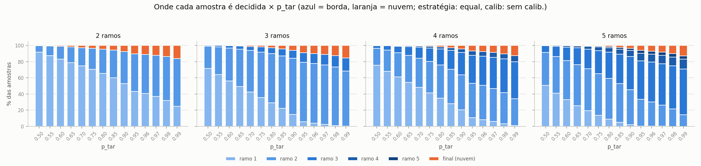
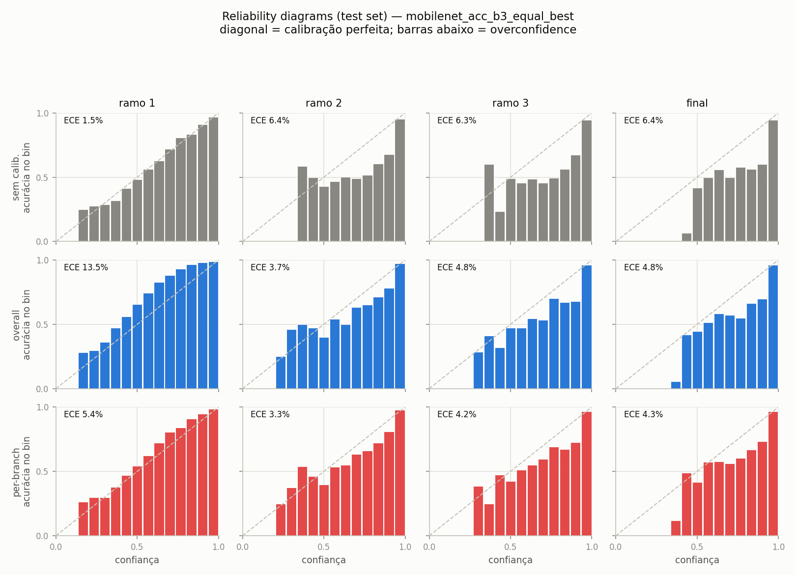
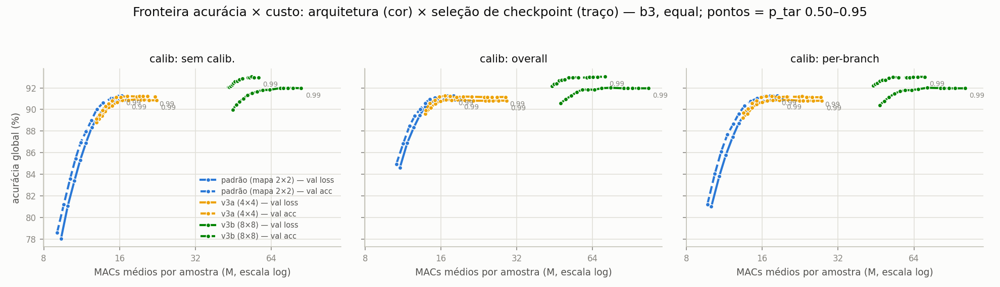
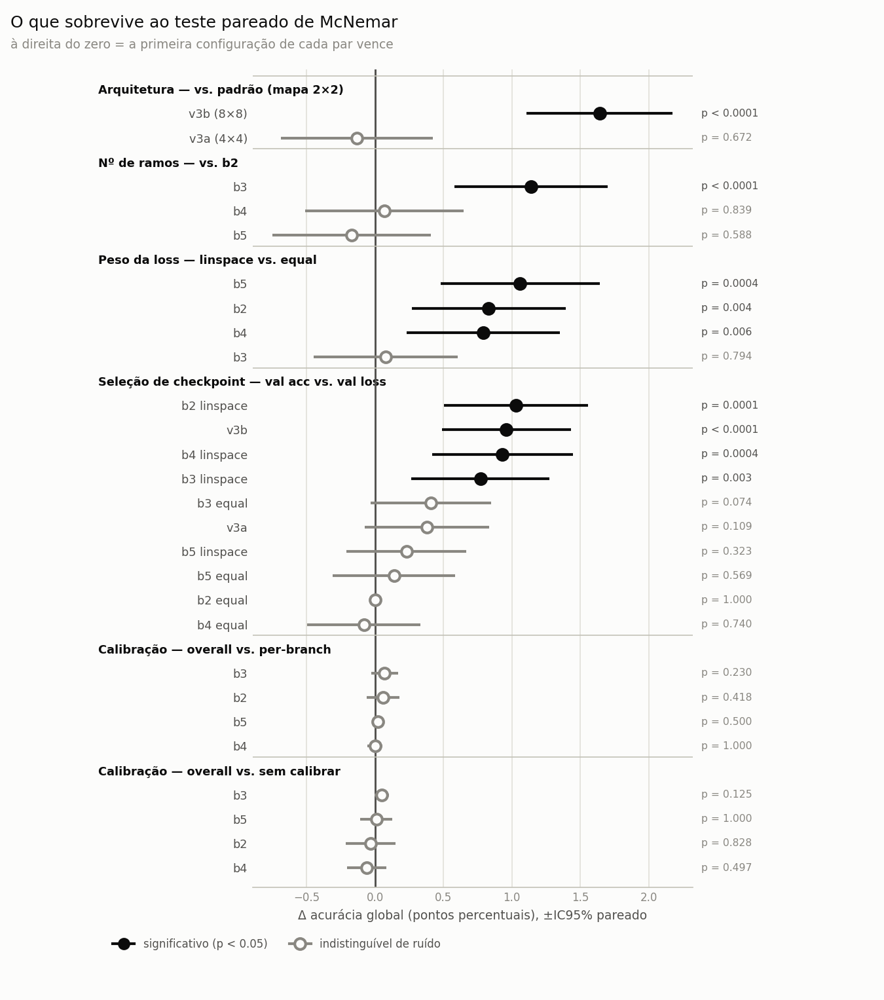

# TCC: DNN com saídas antecipadas para inferência híbrida edge/cloud

Código e resultados de um trabalho de conclusão de curso sobre redes neurais com saídas
antecipadas (early exits) aplicadas à inferência dividida entre um dispositivo de borda e
um servidor na nuvem.

A rede é uma MobileNetV2 com classificadores intermediários, treinada em CIFAR10. Na
inferência, cada amostra percorre a rede até o primeiro classificador cuja confiança atinge
um limiar `p_tar`. Na proposta, os primeiros classificadores rodariam no dispositivo de
borda, e o restante da rede em um servidor, acionado só quando nenhuma saída antecipada é
confiante o bastante. Assim as amostras fáceis seriam resolvidas cedo, e só as difíceis
passariam pela rede inteira.

```
imagem ─► [stage 1] ─► ramo 1 ─ conf ≥ p_tar? ─ sim ─► classe   ┐
              │                     não                          │ borda (edge)
              ▼                                                  │
          [stage 2] ─► ramo 2 ─ conf ≥ p_tar? ─ sim ─► classe   ┘
              │                     não
              ▼
          [stage final] ─► saída final ─► classe                 ─ nuvem (cloud)
```

Escopo: este repositório avalia a rede e a cascata em acurácia e em custo computacional.
A execução com borda e nuvem separadas ainda não foi testada.

## 1. Modelo

Os modelos são identificados por bN, em que N é o número de saídas antecipadas (b2 a b5).
Todos têm, além delas, a saída final da rede.

| Parâmetro | Valor |
|---|---|
| Backbone | MobileNetV2 (`torchvision`), pesos do ImageNet (`IMAGENET1K_V1`) |
| Saídas antecipadas | 2 a 5 (`N_BRANCHES`) |
| Posicionamento das saídas | linear em FLOPs acumulados (medidos com `thop`) |
| Classes | 10 (CIFAR10) |
| Entrada | 32×32×3 |

### Adaptação para imagens 32×32

A MobileNetV2 foi projetada para entradas 224×224. Para preservar a resolução espacial das
imagens do CIFAR10, o stride do primeiro conv foi reduzido de 2 para 1 (`3×3, padding=1`).
Essa camada é reinicializada; as demais mantêm os pesos do ImageNet.

Mesmo com essa mudança, o mapa de features final tem 2×2 pixels (7×7 na rede original), e
os cinco últimos blocos operam sobre 4 pixels. A seção 6 mostra que isso limita a
acurácia máxima.

### Saídas

Cada saída antecipada é um classificador leve ligado a um bloco intermediário:

```
AdaptiveAvgPool2d(1×1) → Flatten → Linear(C → 128) → ReLU → Dropout(0.5) → Linear(128 → 10)
```

`C` é o número de canais do bloco, obtido por um forward com entrada fictícia. A saída
final usa pooling global seguido de `Dropout(0.2) → Linear(1280 → 10)`. O dropout na saída
final deixa todas as cabeças regularizadas, o que evita enviesar a comparação de
calibração entre elas.

### Posicionamento das saídas

Os FLOPs de cada bloco de `features[]` são medidos com `thop.profile` e acumulados. As N
saídas antecipadas ficam nos primeiros blocos que atingem as frações `i/(N+1)` do custo
total, de modo que o espaçamento entre elas é igual em computação, não em número de
camadas.

| Modelo | Posições das saídas | MACs acumulados por saída (M) |
|---|---|---|
| b2 | 5, 13 | 9.8 / 19.2 / 26.6 |
| b3 | 3, 10, 14 | 7.4 / 14.2 / 20.5 / 26.6 |
| b4 | 3, 6, 12, 15 | 7.4 / 10.8 / 17.2 / 21.8 / 26.6 |
| b5 | 2, 5, 10, 13, 16 | 4.9 / 9.8 / 14.2 / 19.2 / 23.1 / 26.6 |

## 2. Dados e treinamento

| Hiperparâmetro | Valor |
|---|---|
| Dataset | CIFAR10 (50k treino / 10k teste) |
| Divisão | 40k treino / 5k validação de seleção / 5k validação de calibração, `SEED=42` |
| Augmentation | `RandomCrop(32, pad=4)` e `RandomHorizontalFlip`, só no treino |
| Normalização | estatísticas do ImageNet |
| Loss | soma ponderada de `CrossEntropyLoss` sobre todas as saídas |
| Fase 1 (warmup) | 5 épocas com o backbone congelado; treinam só as cabeças novas (saídas antecipadas, classificador final e primeiro conv), Adam `lr=1e-3` |
| Fase 2 (ajuste fino) | rede inteira, Adam `lr=1e-4` |
| Early stopping | paciência de 30 épocas na validação de seleção, `min_delta` de 1e-4 (loss) ou 0.05 pp (acurácia), máximo de 150 épocas |
| Batch size | 128 |

A validação é dividida em duas partes disjuntas: `val_select`, usada para early stopping e
escolha de checkpoint, e `val_calib`, usada apenas para ajustar as temperaturas da
calibração. Assim o conjunto que escolhe o modelo não é o mesmo que calibra suas
probabilidades.

Cada treino salva dois checkpoints: o de menor loss de validação e o de maior acurácia de
validação. Como vêm da mesma trajetória, a diferença entre eles isola o efeito do critério
de seleção (seção 6). Salvo indicação em contrário, os resultados usam o checkpoint
escolhido por acurácia.

### Pesos da loss

* `equal`: peso 1.0 em todas as saídas.
* `linspace`: pesos crescentes de 0.15 na saída mais rasa a 1.0 na final, como no BranchyNet.
* O código também aceita `inv_linspace` e pesos definidos em CSV.

### Acurácia por saída (teste, checkpoint por acurácia)

| Modelo | Pesos | Saída 1 | Saída 2 | Saída 3 | Saída 4 | Saída 5 | Final |
|---|---|---|---|---|---|---|---|
| b2 | equal | 81.22 | 90.43 | | | | 90.15 |
| b2 | linspace | 74.96 | 90.82 | | | | 90.98 |
| b3 | equal | 67.96 | 89.61 | 91.45 | | | 91.27 |
| b3 | linspace | 61.94 | 89.40 | 91.35 | | | 91.30 |
| b4 | equal | 67.78 | 84.27 | 89.57 | 90.37 | | 90.24 |
| b4 | linspace | 61.79 | 82.23 | 90.67 | 91.17 | | 91.04 |
| b5 | equal | 53.49 | 78.57 | 88.67 | 90.01 | 89.98 | 89.96 |
| b5 | linspace | 49.11 | 76.32 | 89.35 | 90.65 | 90.93 | 91.07 |

Com `equal` as saídas rasas são melhores (de 4 a 6 pp na primeira); com `linspace`, as
saídas profundas.

## 3. Calibração

Temperature scaling (Guo et al., 2017): os logits são divididos por uma temperatura `T`
antes do softmax (`softmax(z/T)`). `T` é otimizada com LBFGS (valor inicial 1.5,
`lr=0.01`, 50 iterações), minimizando a NLL em `val_calib`. Há três modos: `none` (sem
calibração), `overall` (uma única `T` para todas as saídas) e `branches` (uma `T` por
saída).

| Modelo | Pesos | T por saída (rasa → final) | T overall |
|---|---|---|---|
| b2 | equal | 1.30, 1.76, 1.80 | 1.61 |
| b2 | linspace | 1.25, 1.76, 1.80 | 1.58 |
| b3 | equal | 1.21, 1.66, 1.78, 1.78 | 1.59 |
| b3 | linspace | 1.17, 1.61, 1.79, 1.79 | 1.58 |
| b4 | equal | 1.22, 1.35, 1.73, 1.79, 1.80 | 1.57 |
| b4 | linspace | 1.15, 1.31, 1.71, 1.79, 1.80 | 1.54 |
| b5 | equal | 1.20, 1.29, 1.61, 1.76, 1.78, 1.79 | 1.58 |
| b5 | linspace | 1.19, 1.26, 1.59, 1.76, 1.79, 1.79 | 1.56 |

A temperatura cresce com a profundidade da saída em todos os modelos, ou seja, as saídas
profundas são as mais overconfident.



Com limiar fixo, a calibração aumenta a acurácia quando `p_tar` é baixo (de 2.8 pp em b2 a
9.8 pp em b5, com `p_tar` 0.50), e o efeito desaparece perto de 0.95. O ganho é maior nos
modelos com mais saídas, que têm mais pontos de decisão sujeitos a erro de confiança.
Quando o limiar é escolhido separadamente para cada configuração, o ganho deixa de existir
(seção 7).

## 4. Avaliação da cascata

* Test set completo (10k amostras). Os logits de todas as saídas são calculados uma vez e
  reutilizados.
* `p_tar` de 0.50 a 0.95 em passos de 0.05, mais 0.96, 0.97, 0.98 e 0.99 (14 valores),
  combinados com os 3 modos de calibração. Os valores acima de 0.95 são necessários para
  modelos com saída rasa muito forte, que de outro modo resolveriam quase todas as
  amostras num único ponto da curva.
* A amostra sai na primeira saída com confiança ≥ `p_tar`; se nenhuma atinge o limiar, sai
  na final.
* A avaliação é feita no teste e na validação. Na seção 7, o limiar é escolhido na
  validação.
* Intervalo de confiança: IC95% binomial, com meia largura `1.96·√(p(1−p)/n)`.
* Custo: `E[MACs] = Σ frac_i · MACs_acum_i`, em que `frac_i` é a fração de amostras que sai
  na saída i (colunas `macs_mean_M` e `macs_rel_%`). A fração resolvida na borda, sozinha,
  superestima a economia, já que uma saída profunda conta como borda mesmo custando quase
  a rede inteira.

## 5. Resultados



Cada curva corresponde a um modelo e cada ponto a um valor de `p_tar`; pontos mais acima e
à esquerda são melhores. Para a mesma acurácia, b3, b4 e b5 gastam menos computação que
b2. A partir de cerca de 16 M MACs, mais computação não aumenta a acurácia.

Resultados com `p_tar` 0.90, calibração `overall` e checkpoint por acurácia:

| Modelo | Acurácia | MACs médios | % do modelo completo | Vai à saída final |
|---|---|---|---|---|
| b2 `equal` | 90.28 ± 0.58 | 17.4 M | 65% | 13.8% |
| b2 `linspace` | 91.07 ± 0.56 | 18.9 M | 71% | 13.0% |
| b3 `equal` | 91.19 ± 0.56 | 15.8 M | 59% | 9.1% |
| b3 `linspace` | 91.47 ± 0.55 | 16.2 M | 61% | 9.4% |
| b4 `equal` | 90.27 ± 0.58 | 15.6 M | 59% | 9.7% |
| b4 `linspace` | 91.09 ± 0.56 | 16.1 M | 61% | 8.2% |
| b5 `equal` | 90.05 ± 0.59 | 15.2 M | 57% | 9.0% |
| b5 `linspace` | 91.01 ± 0.56 | 15.4 M | 58% | 7.9% |

O modelo completo, sem saídas antecipadas, custa 26.6 M MACs e acerta 91.3%. As cascatas
atingem acurácia equivalente com cerca de 60% desse custo.

### Efeito do limiar

| | |
|---|---|
|  |  |

A acurácia para de crescer a partir de `p_tar` 0.85 (esquerda). Acima disso, limiares
maiores só enviam mais amostras para a nuvem (direita), aumentando o custo sem ganho de
acurácia.

### Distribuição das saídas



Com `equal`, uma parcela maior das amostras sai na primeira saída: 38.4% em b2 com `p_tar`
0.85, contra 20.4% com `linspace`. `linspace` tem acurácia global maior, mas usa pouco as
saídas rasas.

### Calibração por saída



No reliability diagram, pontos abaixo da diagonal indicam excesso de confiança e pontos
acima, falta de confiança.

ECE (%) por saída, `equal`, checkpoint por acurácia:

| Modelo | Calibração | Saída 1 | Saída 2 | Saída 3 | Saída 4 | Saída 5 | Final |
|---|---|---|---|---|---|---|---|
| b3 | none | 1.5 | 6.4 | 6.3 | | | 6.4 |
| b3 | overall | 13.5 | 3.7 | 4.8 | | | 4.8 |
| b3 | branches | 5.4 | 3.3 | 4.2 | | | 4.3 |
| b5 | none | 1.3 | 1.5 | 6.3 | 7.0 | 7.4 | 7.5 |
| b5 | overall | 13.0 | 9.8 | 2.7 | 5.1 | 5.7 | 5.7 |
| b5 | branches | 5.5 | 4.5 | 2.5 | 4.4 | 5.0 | 5.0 |

As saídas rasas já são bem calibradas sem ajuste (ECE entre 1.3 e 1.5%). A temperatura
única, dominada pelas saídas profundas, eleva o ECE delas para cerca de 13%, agora por
falta de confiança. O modo `branches` evita esse problema, mas não melhora a acurácia da
cascata (seção 7).

## 6. Variantes de arquitetura e seleção de checkpoint

Para testar se a resolução do mapa de features limita a acurácia, duas variantes removem
strides internos (`EXTRA_STRIDE1`):

* v3a: stride 1 em `features[14]`, mapa final 4×4, backbone de 46.3 M MACs.
* v3b: stride 1 em `features[7]` e `features[14]`, mapa final 8×8, backbone de 151.6 M MACs.

As três arquiteturas usam b3, `equal` e calibração `overall`, e cada uma é avaliada com os
dois checkpoints do seu treino:

| Arquitetura | Final (teste), sel. por loss | Final, sel. por acurácia | Melhor cascata | MACs no ponto |
|---|---|---|---|---|
| padrão (2×2) | 90.89 | 91.27 | 91.33 ± 0.55 | 16.6 M |
| v3a (4×4) | 90.82 | 91.15 | 91.27 ± 0.55 | 16.6 M |
| v3b (8×8) | 91.96 | 93.01 | 92.98 ± 0.50 | 53.4 M |



A v3b aumenta a melhor acurácia da cascata em 1.65 pp (92.98 contra 91.33, sem
sobreposição dos ICs), com custo 3.2 vezes maior. A v3a não difere da arquitetura padrão.

Na v3b, a primeira saída antecipada sozinha acerta 92.00% com 42.8 M MACs, mais que
qualquer configuração da arquitetura padrão. Com isso quase todas as amostras saem na
primeira saída e a cascata passa a se comportar como um modelo único.

### Critério de seleção de checkpoint

Diferença na acurácia da saída final (teste) entre o checkpoint escolhido por acurácia e o
escolhido por loss:

| Configuração | Δ (acurácia − loss) | Época escolhida por loss | Época escolhida por acurácia |
|---|---|---|---|
| b2 equal | 0.00 | 150 | 150 |
| b3 equal | +0.38 | 93 | 141 |
| b4 equal | −0.08 | 146 | 147 |
| b5 equal | +0.11 | 138 | 144 |
| b2 linspace | +1.09 | 28 | 148 |
| b3 linspace | +0.66 | 48 | 142 |
| b4 linspace | +0.92 | 30 | 142 |
| b5 linspace | +0.15 | | 149 |
| v3b | +1.05 | 19 | 90 |

A diferença não depende do tamanho do modelo, e sim de quando a loss de validação atinge o
mínimo. Nas configurações em que isso acontece cedo (`linspace` e v3b, entre as épocas 19 e
48), selecionar por loss interrompe o treino enquanto a acurácia ainda subiria por cerca de
100 épocas. É o overfitting de NLL descrito por Guo et al., aqui afetando a seleção de
modelo.

## 7. Análise estatística

Implementada em [src/stats.py](src/stats.py), com dois cuidados:

1. Limiar escolhido na validação. Escolher o melhor `p_tar` diretamente no teste, entre 14
   limiares, 3 calibrações e 20 modelos, superestima o resultado. O limiar é escolhido pela
   acurácia em `val_select` e o teste é avaliado só nesse ponto. Os limiares escolhidos
   ficam entre 0.95 e 0.99, e as acurácias ficam de 0.1 a 0.4 pp abaixo das obtidas
   escolhendo no teste.
2. Teste de McNemar exato pareado. Como todos os modelos classificam as mesmas 10k
   amostras, a comparação considera apenas as amostras em que eles discordam. Isso é mais
   sensível do que comparar ICs, que tratam as medidas como independentes.



Das 27 comparações, 6 são significativas: v3b contra a arquitetura padrão, `linspace`
contra `equal` em 3 dos 4 tamanhos, b3 contra b2 e o critério de seleção de checkpoint nas
configurações em que a loss atinge o mínimo cedo. Não são significativas: `overall` contra
`branches`, calibração contra nenhuma calibração no limiar ótimo, v3a contra a arquitetura
padrão e o critério de seleção nos modelos `equal`.

Nos blocos de calibração, os intervalos são estreitos e centrados em zero, o que indica
ausência de efeito. No bloco de número de saídas, b4 e b5 contra b2 têm intervalos largos:
a diferença não é significativa, mas também não é possível afirmar que os modelos sejam
equivalentes.

Os resultados de todas as comparações estão em `results/stats_comparisons.csv`.

## 8. Resumo dos achados

| # | Achado | Evidência | Significância |
|---|---|---|---|
| 1 | O peso da loss define como a cascata é usada: `linspace` dá maior acurácia, `equal` resolve mais amostras nas saídas rasas | `linspace` supera `equal` em 0.79 a 1.06 pp em b2, b4 e b5 (empate em b3); `equal` resolve 38.4% na primeira saída contra 20.4% | p ≤ 0.006 |
| 2 | Com mapa final 2×2, nenhuma configuração passa de 91.5%; com 8×8, a acurácia chega a 93.0% | v3b supera a arquitetura padrão em 1.64 pp, com custo 3.2 vezes maior; v3a (4×4) não difere (p = 0.67) | p < 0.0001 |
| 3 | Mais saídas reduzem o custo, mas não aumentam a acurácia de forma consistente | b3 supera b2 em 1.14 pp; b4 e b5 não diferem de b2. No mesmo limiar, o custo cai de 17.4 para 15.2 M MACs | p < 0.0001 |
| 4 | O critério de seleção de checkpoint só faz diferença quando a loss de validação atinge o mínimo cedo | ganho de 0.77 a 1.03 pp em `linspace` e v3b (mínimo da loss entre as épocas 19 e 48); nenhum efeito nos modelos `equal` | p ≤ 0.003 |
| 5 | A calibração só melhora a acurácia quando o limiar é fixo | com `p_tar` 0.50 o ganho vai de 2.8 a 9.8 pp; com o limiar escolhido por configuração, desaparece | p entre 0.13 e 1.00 (não sig.) |
| 6 | Calibrar por saída não melhora a cascata em relação à temperatura única | `branches` tem ECE menor, mas as duas discordam em apenas 2 a 38 das 10k amostras | p entre 0.23 e 1.00 (não sig.) |

Observações:

* Dentro da cascata, a saída final acerta entre 40 e 60% porque recebe apenas as amostras
  que nenhuma saída antecipada resolveu, que são as mais difíceis.
* Na v3b o efeito da temperatura única se inverte: a primeira saída é overconfident (ECE
  de 5.0%) e a calibração `overall` a melhora (2.4%).

## 9. Estrutura do repositório

```
src/
  model.py       # MobileNetV2EarlyExit paramétrico, posicionamento por FLOPs,
                 #   MACs por saída, variantes de stride
  data.py        # datasets, divisão treino/val_select/val_calib, normalização
  train.py       # treino em 2 fases, pesos da loss, dois checkpoints por treino
  calibrate.py   # temperature scaling (overall e por saída), LBFGS
  inference.py   # cascata edge→cloud: p_tar × calibração → CSVs
  plots.py       # figuras a partir dos CSVs
  reliability.py # reliability diagrams e ECE por saída
  stats.py       # limiar escolhido na validação e McNemar pareado
  serving/       # servidores Flask de borda e nuvem, cliente de latência
saved_model/     # checkpoints (pesos, posições das saídas, temperaturas, metadados)
results/         # CSVs da cascata; stats_comparisons.csv com as 27 comparações;
                 #   latency/ com medições preliminares; legacy_prev4/ com
                 #   resultados de versões anteriores, não usados neste documento
plots/ logs/ data/ fontes/
run_retrain_v4.sh   # pipeline completo: treino, calibração, inferência e figuras
run_experiments.sh  # apenas a grade b2 a b5
```

## 10. Como reproduzir

Requer [uv](https://docs.astral.sh/uv/) e, de preferência, uma GPU CUDA.

```bash
uv sync && uv pip install -r requirements.txt

# pipeline completo (grade, variantes e figuras), cerca de 11h:
./run_retrain_v4.sh

# ou por etapa:
N_BRANCHES=3 LOSS_WEIGHTS_LIST=equal uv run python -m src.train
N_BRANCHES=3 uv run python -m src.calibrate      # usa o checkpoint por loss; VARIANT=acc usa o por acurácia
N_BRANCHES=3 uv run python -m src.inference
uv run python -m src.plots
uv run python -m src.reliability
uv run python -m src.stats        # requer os results/preds/*.npz gerados pela inferência

# servidores de borda e nuvem, medição preliminar (3 terminais, ou nohup):
CHECKPOINT=saved_model/mobilenet_acc_b3_equal_best.pth uv run python -m src.serving.cloud
CHECKPOINT=saved_model/mobilenet_acc_b3_equal_best.pth LINK_MBPS=10 LINK_RTT_MS=50 \
    uv run python -m src.serving.edge
uv run python -m src.serving.client

# variantes de arquitetura:
#   EXTRA_STRIDE1=14    → mapa 4×4 (v3a)
#   EXTRA_STRIDE1=7,14  → mapa 8×8 (v3b)
```

## Referências

* Teerapittayanon et al., *BranchyNet: Fast Inference via Early Exiting from Deep Neural Networks* (2016)
* Guo et al., *On Calibration of Modern Neural Networks* (2017)
* Sandler et al., *MobileNetV2: Inverted Residuals and Linear Bottlenecks* (2018)
* PDFs em [fontes/](fontes/)
