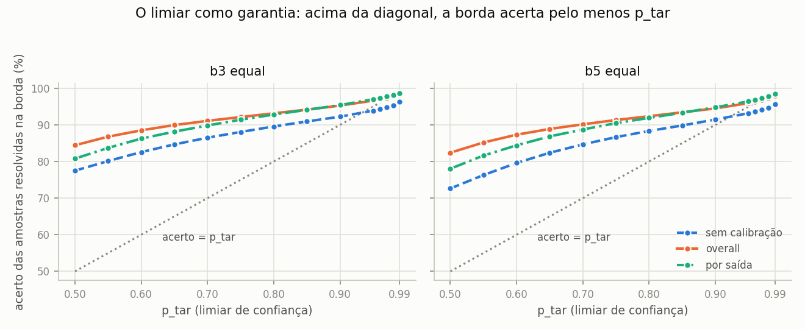
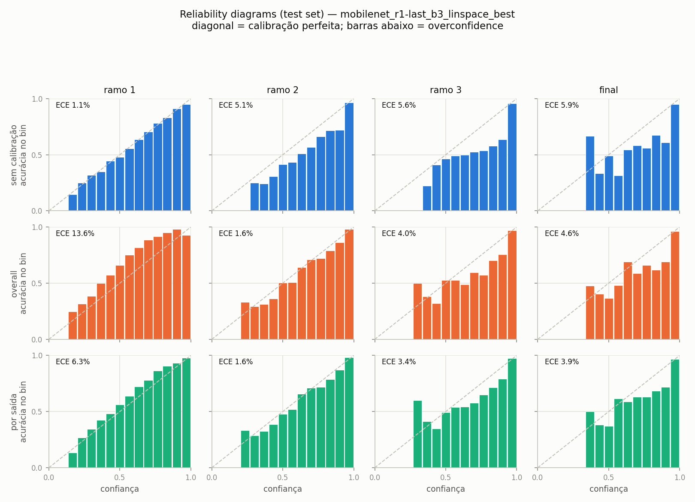
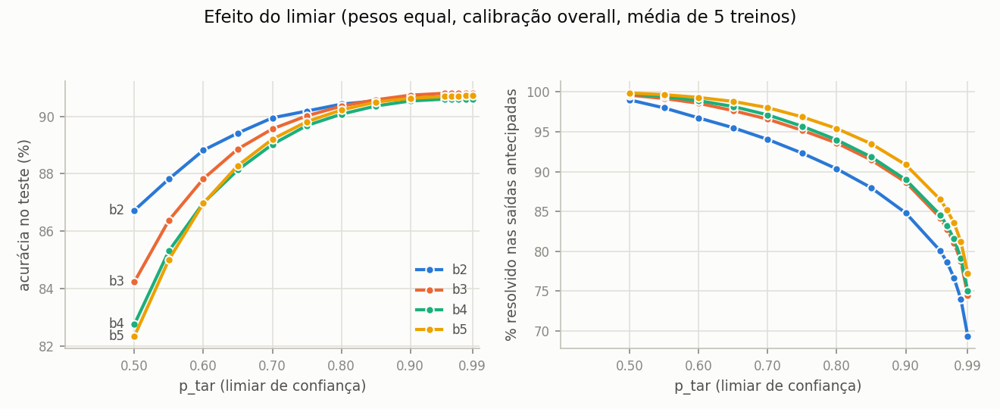
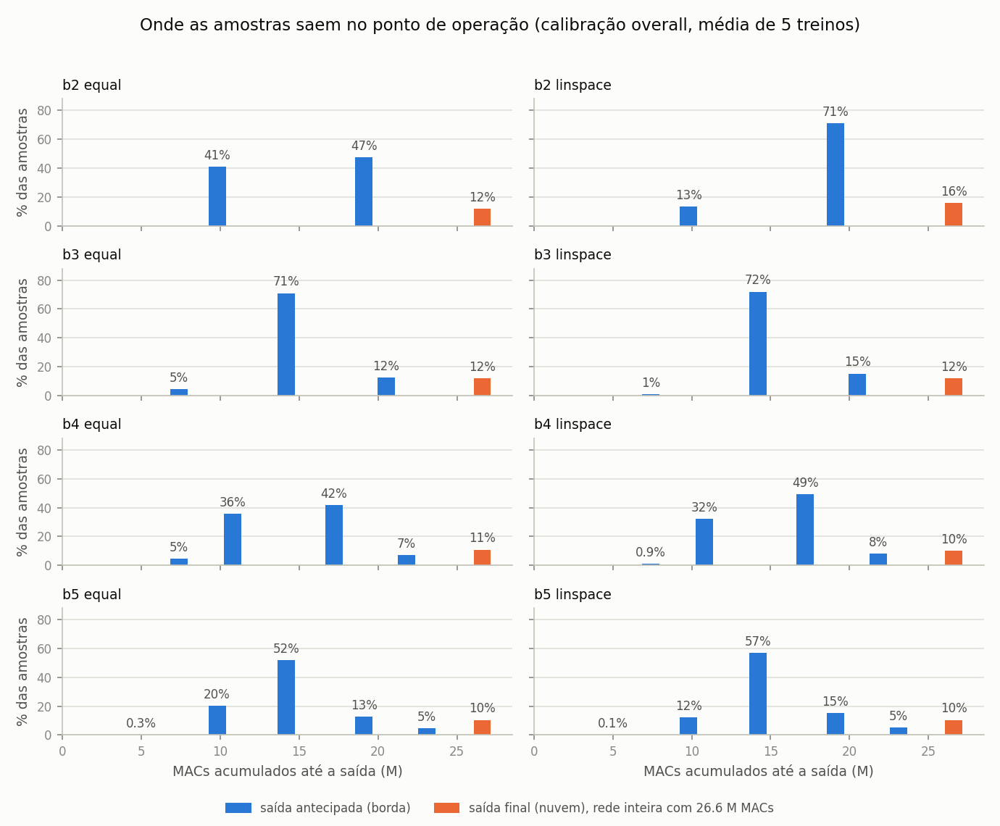
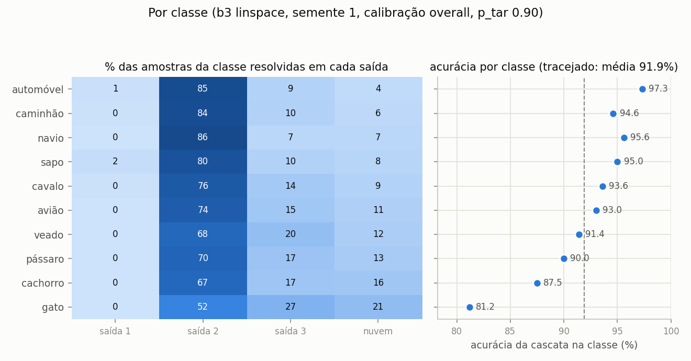
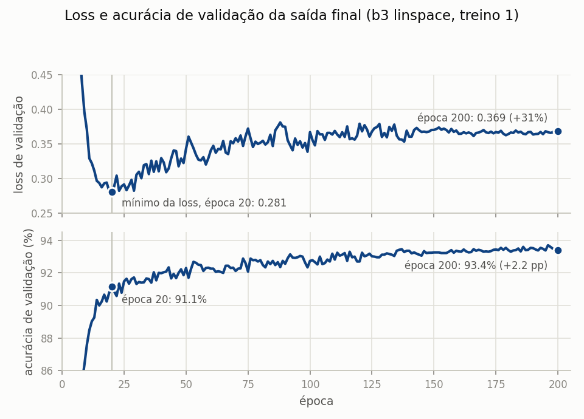

# TCC: DNN com saídas antecipadas para inferência híbrida edge/cloud

Código e resultados de um trabalho de conclusão de curso sobre redes neurais com saídas
antecipadas (early exits) aplicadas à inferência dividida entre um dispositivo de borda e
um servidor na nuvem.

A rede é uma MobileNetV2 com classificadores intermediários, treinada em CIFAR10. Na
inferência, cada amostra percorre a rede até o primeiro classificador cuja confiança atinge
um limiar `p_tar`. Na proposta, os primeiros classificadores rodariam no dispositivo de
borda, e o restante da rede em um servidor, acionado só quando nenhuma saída antecipada é
confiante o bastante. Assim as amostras fáceis seriam resolvidas cedo, e só as difíceis
passariam pela rede inteira.

```
imagem ─► [stage 1] ─► ramo 1 ─ conf ≥ p_tar? ─ sim ─► classe   ┐
              │                     não                          │ borda (edge)
              ▼                                                  │
          [stage 2] ─► ramo 2 ─ conf ≥ p_tar? ─ sim ─► classe   ┘
              │                     não
              ▼
          [stage final] ─► saída final ─► classe                 ─ nuvem (cloud)
```

Escopo: as seções 1 a 6 avaliam a rede e a cascata em acurácia e em custo computacional
(MACs), com a rede inteira na mesma máquina. A seção 7 mede a cascata em tempo, com a borda
e a nuvem em máquinas separadas e rede real entre elas, e está em andamento.

A configuração escolhida (seção 5) tem três saídas antecipadas, pesos da loss crescentes
com a profundidade da saída (`linspace`), calibração por uma temperatura única (`overall`)
e `p_tar` 0.90. No teste, na média de 5 treinos, ela acerta 91.45% das imagens, contra
90.90% da mesma rede sem saídas antecipadas, gasta 62% dos MACs dessa rede e resolve 89.0%
das amostras na borda.

## 1. Modelo

Os modelos são identificados por bN, em que N é o número de saídas antecipadas (b2 a b5).
Todos têm, além delas, a saída final da rede. O b0 é a mesma rede sem saídas antecipadas,
treinada com a mesma receita, usada como referência.

| Parâmetro | Valor |
|---|---|
| Backbone | MobileNetV2 (`torchvision`), pesos do ImageNet (`IMAGENET1K_V1`) |
| Saídas antecipadas | 2 a 5 (`N_BRANCHES`) |
| Posicionamento das saídas | linear em MACs acumulados (medidos com `thop`), como no framework de referência |
| Parâmetros | 2.24 M no b0; as saídas antecipadas somam de 1.6 k (b2) a 4.6 k (b5) |
| Pesos em float32 | 8.5 MB |
| Maior ativação intermediária | 384 KB (lote de 1 imagem, float32), igual em todos |
| Classes | 10 (CIFAR10) |
| Entrada | 32×32×3 |

### Adaptação para imagens 32×32

A MobileNetV2 foi projetada para entradas 224×224. Para preservar a resolução espacial das
imagens do CIFAR10, o stride do primeiro conv foi reduzido de 2 para 1 (`3×3, padding=1`).
Essa camada é reinicializada; as demais mantêm os pesos do ImageNet.

Mesmo com essa mudança, o mapa de features final tem 2×2 pixels (7×7 na rede original), e
os cinco últimos blocos operam sobre 4 pixels.

Para medir o efeito dessa perda de resolução, há uma variante, a v3b, em que os blocos 7 e
14 deixam de reduzir o mapa pela metade (stride 1 em vez de 2). O mapa final passa a ter 8×8
pixels, e o custo do backbone sobe de 26.6 para 151.6 M MACs. Ela é avaliada só como b3 com
`equal`, e a seção 6 traz os resultados.

### Saídas

Cada saída antecipada é um classificador ligado a um bloco intermediário:

```
BatchNorm2d(C) → AdaptiveAvgPool2d(1×1) → Flatten → Linear(C → 10)
```

`C` é o número de canais do bloco. É a cabeça do framework de referência do grupo
(`exit_type = "bnpool"`). A saída final é a cabeça original da MobileNetV2: pooling global seguido de
`Dropout(0.2) → Linear(1280 → 10)`.

### Posicionamento, custo e memória por saída

Os MACs de cada bloco de `features[]` são medidos com `thop.profile` e acumulados (o código
e o framework de referência chamam essa contagem de FLOPs). As N saídas antecipadas ficam
nos primeiros blocos que atingem as frações `i/(N+1)` do custo total, de modo que o
espaçamento entre elas é igual em computação, não em número de camadas.

| Modelo | Posições das saídas | MACs acumulados por saída (M) | Parâmetros acumulados por saída (M) |
|---|---|---|---|
| b2 | 5, 13 | 9.8 / 19.1 / 26.6 | 0.04 / 0.54 / 2.24 |
| b3 | 3, 10, 14 | 7.4 / 14.2 / 20.5 / 26.6 | 0.02 / 0.24 / 0.70 / 2.24 |
| b4 | 3, 6, 12, 15 | 7.4 / 10.8 / 17.2 / 21.8 / 26.6 | 0.02 / 0.06 / 0.43 / 1.02 / 2.24 |
| b5 | 2, 5, 10, 13, 16 | 5.0 / 9.8 / 14.2 / 19.1 / 23.1 / 26.6 | 0.01 / 0.04 / 0.24 / 0.55 / 1.34 / 2.24 |

Os parâmetros acumulados contam os blocos e as cabeças de todas as saídas até aquele ponto,
que é o que um dispositivo precisaria guardar para executar a cascata até ali.

### O que seria enviado à nuvem

Quando nenhuma saída da borda atinge o limiar, a borda envia à nuvem o mapa de features do
ponto de corte, e a nuvem continua a inferência dali. A alternativa é enviar a imagem
original e deixar a nuvem refazer a rede inteira. Tamanho do mapa em cada posição de saída,
comparado com a imagem de 32×32 (3.0 KB crua, 2.2 KB em PNG, média de 1000 imagens de teste):

| Corte depois do bloco | Onde aparece | Formato | float32 | float16 | int8 |
|---|---|---|---|---|---|
| 2 e 3 | primeira saída do b3, b4 e b5 | 24×16×16 | 24 KB | 12 KB | 6 KB |
| 5 e 6 | b2, b4, b5 | 32×8×8 | 8 KB | 4 KB | 2 KB |
| 10 | b3, b5 | 64×4×4 | 4 KB | 2 KB | 1 KB |
| 12 e 13 | b2, b4, b5 | 96×4×4 | 6 KB | 3 KB | 1.5 KB |
| 14, 15 e 16 | última saída antecipada do b3, b4 e b5 | 160×2×2 | 2.5 KB | 1.25 KB | 0.6 KB |

Em float32, o mapa só fica menor que a imagem crua a partir do bloco 14 (2.5 contra 3.0 KB),
e ainda é maior que o PNG. Em float16, fica menor que as duas no bloco 10 e a partir do bloco
14. Nos cortes mais rasos, depois dos blocos 2 a 6, o mapa em float32 tem de 2.7 a 8 vezes o
tamanho da imagem crua e de 3.6 a 11 vezes o do PNG. Só vale particionar onde o volume de
dados encolhe, e em imagens de 32×32 isso acontece apenas nos blocos profundos. Em resolução maior a imagem pesa muito mais e a conta muda.

## 2. Dados e treinamento

| Hiperparâmetro | Valor |
|---|---|
| Dataset | CIFAR10 (50k treino / 10k teste) |
| Divisão | 40k treino / 5k validação de seleção / 5k validação de calibração |
| Sementes | cada configuração foi treinada 5 vezes. O treino s usa `TRAIN_SEED` s e uma divisão própria dos dados (`SPLIT_SEED` 41 + s), a mesma para todas as configurações daquele treino |
| Augmentation | `RandomCrop(32, pad=4)` e `RandomHorizontalFlip`, só no treino, feitos na GPU |
| Normalização | estatísticas do ImageNet |
| Loss | soma ponderada de `CrossEntropyLoss` sobre todas as saídas |
| Fase 1 (warmup) | 5 épocas com o backbone congelado; treinam só as cabeças novas (saídas antecipadas, classificador final e primeiro conv), Adam `lr=1e-3` |
| Fase 2 (ajuste fino) | rede inteira, Adam `lr=1e-4` com decaimento em cosseno até zero na época 200 |
| Weight decay | 0.00005 nas duas fases (o valor do framework de referência) |
| Duração | 200 épocas fixas, sem early stopping |
| Batch size | 128 |

A validação é dividida em duas partes disjuntas: `val_select`, usada para escolher o limiar
da cascata, e `val_calib`, usada apenas para ajustar as temperaturas da calibração. Assim o
conjunto que escolhe o ponto de operação não é o mesmo que calibra as probabilidades. O
teste é sempre o conjunto oficial de 10 mil imagens.

Cada treino salva três modelos da mesma trajetória:

* **última época**: o modelo usado em todos os resultados;
* **por acurácia**: a época com a maior média de acurácia de validação entre as saídas;
* **por loss**: a época com a menor loss de validação ponderada.

A seção 6 compara os três.

### Pesos da loss

* `equal`: peso 1.0 em todas as saídas.
* `linspace`: pesos crescentes de 0.15 na saída mais rasa a 1.0 na final.
* `inv_linspace`: pesos decrescentes de 1.0 a 0.15, mais peso nas saídas rasas. Não faz parte
  da grade: é um teste do esquema oposto ao `linspace`, avaliado só no b3 para limitar o tempo
  de treino (cerca de 3 h, contra 11 h na grade inteira). Como perde para `equal` e para
  `linspace` nos 5 treinos, os outros tamanhos usam só esses dois.

### Acurácia por saída

Cada saída é avaliada sozinha sobre as 10 mil imagens de teste, sem cascata: uma imagem que
sairia na primeira saída também conta nas seguintes. Média e desvio padrão de 5 treinos.

| Modelo | Pesos | Saída 1 | Saída 2 | Saída 3 | Saída 4 | Saída 5 | Final |
|---|---|---|---|---|---|---|---|
| b0 | | | | | | | 90.90 ± 0.56 |
| b2 | equal | 81.55 ± 0.67 | 90.21 ± 0.10 | | | | 90.53 ± 0.27 |
| b2 | linspace | 74.40 ± 0.80 | 90.77 ± 0.28 | | | | 91.26 ± 0.29 |
| b3 | equal | 67.20 ± 0.43 | 88.92 ± 0.38 | 90.70 ± 0.13 | | | 90.84 ± 0.23 |
| b3 | linspace | 58.60 ± 1.18 | 89.14 ± 0.36 | 91.34 ± 0.49 | | | 91.62 ± 0.45 |
| b3 | inv_linspace | 69.71 ± 0.46 | 88.48 ± 0.16 | 89.87 ± 0.25 | | | 89.83 ± 0.23 |
| b4 | equal | 66.03 ± 0.35 | 83.70 ± 0.62 | 89.63 ± 0.30 | 90.34 ± 0.30 | | 90.48 ± 0.32 |
| b4 | linspace | 57.54 ± 0.92 | 81.34 ± 0.52 | 90.03 ± 0.41 | 90.85 ± 0.39 | | 90.82 ± 0.35 |
| b5 | equal | 53.02 ± 1.10 | 79.04 ± 0.38 | 88.92 ± 0.14 | 90.33 ± 0.10 | 90.61 ± 0.20 | 90.60 ± 0.25 |
| b5 | linspace | 44.31 ± 0.92 | 74.97 ± 0.59 | 88.73 ± 0.28 | 90.44 ± 0.30 | 91.00 ± 0.34 | 90.97 ± 0.40 |

Quanto mais peso uma saída recebe, mais ela acerta. Com `equal`, a primeira saída acerta de
7.2 a 8.7 pp mais que com `linspace`; com `linspace`, a saída final acerta de 0.34 a 0.78 pp
mais. O `inv_linspace` dá a primeira saída mais forte do b3 (69.71%) e a saída final mais
fraca (89.83%).

Comparada ao b0, a saída final só fica acima de forma confirmada no b3 `linspace` (+0.71 pp;
IC95% de +0.16 a +1.27). No b4 `equal` ela fica abaixo (−0.42 pp; IC95% de −0.80
a −0.04), e no `inv_linspace`, mais abaixo ainda (−1.07 pp). Nas demais configurações a
diferença está dentro do ruído. Treinar as saídas antecipadas junto não melhora a saída
final de forma geral com esta receita.

### Pré treino no ImageNet

O b0 treinado do zero, com a mesma receita e sem os pesos do ImageNet, acerta 74.32 ± 0.68%,
contra 90.90 ± 0.56% com os pesos: 16.6 pp a mais nos 5 treinos. Mesmo com imagens de 32×32,
bem menores que as 224×224 do pré treino, os pesos do ImageNet são a maior fonte de
acurácia do modelo.

## 3. Calibração

Temperature scaling: os logits são divididos por uma temperatura `T`
antes do softmax (`softmax(z/T)`). `T` é otimizada com LBFGS (valor inicial 1.5,
`lr=0.01`, 50 iterações), minimizando a NLL em `val_calib`. Há três modos: `none` (sem
calibração), `overall` (uma única `T` para todas as saídas) e `branches` (uma `T` por
saída).

Temperaturas, média de 5 treinos:

| Modelo | Pesos | T por saída (rasa → final) | T overall |
|---|---|---|---|
| b2 | equal | 1.31, 1.74, 1.76 | 1.60 |
| b2 | linspace | 1.25, 1.72, 1.75 | 1.54 |
| b3 | equal | 1.24, 1.64, 1.77, 1.76 | 1.59 |
| b3 | linspace | 1.22, 1.57, 1.75, 1.75 | 1.56 |
| b4 | equal | 1.24, 1.33, 1.70, 1.78, 1.77 | 1.55 |
| b4 | linspace | 1.22, 1.29, 1.66, 1.76, 1.76 | 1.52 |
| b5 | equal | 1.26, 1.29, 1.61, 1.74, 1.78, 1.76 | 1.56 |
| b5 | linspace | 1.32, 1.27, 1.56, 1.73, 1.78, 1.75 | 1.56 |

A temperatura cresce, em geral, com a profundidade da saída: as saídas profundas são as mais
overconfident. O desvio da temperatura entre treinos é de 0.01 a 0.02.

### Com limiar fixo, a calibração aumenta a acurácia e o custo


Com `p_tar` 0.50, a calibração `overall` leva o b5 `equal` de 72.6% a 82.3% de acurácia, mas o
custo sobe de 7.6 para 9.6 M MACs: a temperatura reduz as confianças, e mais amostras
descem para saídas profundas. No b2 `equal`, o mesmo limiar vai de 84.2% a 86.7%, e o custo
de 10.6 para 11.6 M MACs. No eixo do custo (painel da direita) as três curvas praticamente
se sobrepõem. No ponto de operação escolhido na validação, a diferença entre `overall` e
`none` fica entre −0.05 e +0.07 pp em média, com o intervalo de confiança contendo zero em
todas as 10 configurações.

### Acerto na borda e na nuvem



A borda só responde quando alguma saída tem confiança de pelo menos `p_tar`, então o esperado
é que essas respostas acertem pelo menos `p_tar` das vezes, o que aqui se chama garantia do
limiar. Sem calibração ela deixa de valer nos limiares altos, porque a rede é mais confiante
do que deveria.

A tabela mostra a acurácia das amostras resolvidas na borda nos 40 modelos da grade b2 a b5
(8 configurações, 5 treinos cada): a média dos 40 e, entre parênteses, o pior modelo.

| `p_tar` | Sem calibração | `overall` | `branches` |
|---|---|---|---|
| 0.50 | 76.7% (71.0%) | 84.2% (82.3%) | 80.8% (77.3%) |
| 0.55 | 79.7% (75.3%) | 86.7% (85.0%) | 83.8% (81.4%) |
| 0.60 | 82.3% (79.2%) | 88.5% (87.2%) | 86.2% (84.2%) |
| 0.65 | 84.5% (82.1%) | 90.0% (88.5%) | 88.3% (86.6%) |
| 0.70 | 86.5% (84.5%) | 91.2% (89.8%) | 90.0% (88.5%) |
| 0.75 | 88.2% (86.4%) | 92.3% (91.0%) | 91.6% (90.2%) |
| 0.80 | 89.7% (88.1%) | 93.3% (92.0%) | 92.9% (91.6%) |
| 0.85 | 91.1% (89.6%) | 94.3% (93.1%) | 94.2% (92.9%) |
| 0.90 | 92.5% (91.1%) | 95.4% (94.1%) | 95.6% (94.2%) |
| 0.95 | 94.1% (92.8%) | 96.6% (95.5%) | 97.0% (96.1%) |
| 0.96 | 94.5% (93.2%) | 96.9% (95.9%) | 97.3% (96.6%) |
| 0.97 | 95.0% (93.7%) | 97.3% (96.3%) | 97.7% (97.1%) |
| 0.98 | 95.6% (94.3%) | 97.7% (97.1%) | 98.2% (97.6%) |
| 0.99 | 96.3% (95.1%) | 98.3% (97.8%) | 98.7% (98.2%) |

A acurácia na borda fica acima de `p_tar` em todos os modelos até 0.90 sem calibração, até
0.95 com `overall` (em 0.96, um dos 40 fica abaixo) e até 0.97 com `branches`. O pior modelo
é sempre um b5 `equal`.

A tabela seguinte usa os mesmos modelos e limiares. Cada célula traz a fração das imagens de
teste enviada à nuvem e, depois da barra, o acerto nessas imagens, na média dos 40.

| `p_tar` | Sem calibração | `overall` | `branches` |
|---|---|---|---|
| 0.50 | 0.1% / 39.7%¹ | 0.4% / 37.8% | 0.5% / 37.1% |
| 0.55 | 0.2% / 39.7%¹ | 0.9% / 38.6% | 0.9% / 40.5% |
| 0.60 | 0.4% / 42.0% | 1.6% / 42.2% | 1.6% / 43.2% |
| 0.65 | 0.8% / 42.1% | 2.4% / 44.6% | 2.6% / 45.5% |
| 0.70 | 1.2% / 43.4% | 3.6% / 46.8% | 3.8% / 47.0% |
| 0.75 | 1.8% / 45.0% | 5.0% / 48.6% | 5.3% / 49.0% |
| 0.80 | 2.7% / 46.1% | 6.6% / 50.3% | 7.2% / 51.2% |
| 0.85 | 3.8% / 48.2% | 8.7% / 52.6% | 9.6% / 53.7% |
| 0.90 | 5.6% / 49.9% | 11.5% / 55.7% | 12.8% / 57.1% |
| 0.95 | 8.5% / 52.8% | 15.8% / 60.5% | 17.8% / 62.2% |
| 0.96 | 9.4% / 53.7% | 17.1% / 61.8% | 19.4% / 63.7% |
| 0.97 | 10.6% / 54.9% | 18.9% / 63.4% | 21.5% / 65.5% |
| 0.98 | 12.2% / 56.7% | 21.3% / 65.7% | 24.4% / 68.1% |
| 0.99 | 14.8% / 59.5% | 25.6% / 69.3% | 29.4% / 71.9% |

¹ Sem calibração, 5 dos 40 modelos em 0.50 e 1 em 0.55 não enviam nenhuma imagem à nuvem; o
acerto é a média dos demais.

As imagens enviadas à nuvem são as que nenhuma saída antecipada resolveu, e o acerto nelas
fica entre 37% e 72%, bem abaixo do da borda. Com `p_tar` maior, mais imagens vão à nuvem, e
as que passam a ir são mais fáceis, então o acerto na nuvem sobe. No mesmo `p_tar`, a
calibração reduz as confianças e manda à nuvem de 1.7 a 5.5 vezes mais imagens que sem
calibração. A razão é maior nos limiares baixos, em que as frações ficam abaixo de 1%.

### Calibração por saída



No reliability diagram, pontos abaixo da diagonal indicam excesso de confiança e pontos
acima, falta de confiança.

O diagrama mostra o b3 `linspace` do primeiro treino. ECE (%) por saída, `linspace`, média
de 5 treinos:

| Modelo | Calibração | Saída 1 | Saída 2 | Saída 3 | Saída 4 | Saída 5 | Final |
|---|---|---|---|---|---|---|---|
| b3 | none | 1.2 | 5.5 | 6.1 | | | 6.3 |
| b3 | overall | 13.1 | 1.9 | 4.4 | | | 4.9 |
| b3 | branches | 5.7 | 1.8 | 3.8 | | | 4.3 |
| b5 | none | 3.2 | 1.4 | 5.3 | 6.3 | 6.5 | 6.9 |
| b5 | overall | 8.4 | 11.0 | 1.4 | 4.3 | 4.9 | 5.3 |
| b5 | branches | 4.4 | 4.9 | 1.4 | 3.6 | 4.2 | 4.6 |

As saídas mais rasas já são bem calibradas sem ajuste (ECE de 1.2 a 3.2%). A temperatura
única, dominada pelas saídas profundas, eleva o ECE delas para 8.4 a 13.1%, agora por falta
de confiança. O modo `branches` reduz esse efeito, mas não muda a acurácia da cascata.

## 4. Avaliação da cascata

* Conjunto de teste completo (10 mil imagens). Os logits de todas as saídas são calculados
  uma vez e reutilizados.
* `p_tar` de 0.50 a 0.95 em passos de 0.05, mais 0.96, 0.97, 0.98 e 0.99,
  combinados com os 3 modos de calibração.
* A amostra sai na primeira saída com confiança ≥ `p_tar`. Se nenhuma atinge o limiar, ela
  vai até a saída final (nuvem), e a classe é a da saída mais confiante entre todas, como no
  framework de referência. Nos modelos desta receita, essa regra empata com usar sempre a
  saída final (−0.03 pp em média; melhor em 17 dos 50 modelos), sem custo adicional,
  porque a amostra já passou por todas as saídas.
* Ponto de operação: o menor `p_tar` cuja acurácia em `val_select` não fica abaixo da saída
  final sozinha, de modo que, na validação, a cascata acerte pelo menos o mesmo que a rede
  inteira. Se nenhum limiar chega lá (15 dos 50 modelos com `overall`), vale o de maior
  acurácia em `val_select` e, no empate, o menor deles. Nesses modelos a acurácia costuma ser
  a mesma de 0.90 ou 0.95 até 0.99, e o menor limiar acerta o mesmo com menos amostras na
  nuvem. O teste é avaliado só nesse ponto, e nele a cascata pode ficar um pouco abaixo da
  saída final (seção 10).
* Variância: as tabelas trazem média e desvio padrão de 5 treinos. As comparações entre
  configurações usam a diferença pareada por treino (mesma divisão de dados) e o IC95% da
  média por t de Student (seção 8).
* Custo: `E[MACs] = Σ frac_i · MACs_acum_i`, em que `frac_i` é a fração de amostras que sai
  na saída i. A fração resolvida na borda diz quanto ficou local; o `E[MACs]` diz quanto
  custou, somando borda e nuvem. Os dois são reportados, porque uma saída profunda conta
  como borda mesmo custando quase a rede inteira.

## 5. Resultados


Cada curva é a média de 5 treinos, cada ponto um valor de `p_tar`, e o círculo vazado marca o
ponto de operação. Pontos mais acima e à esquerda são melhores. Em todos os modelos a
acurácia sobe rápido até cerca de 14 M MACs e estabiliza perto de 16 M; a partir daí, mais
computação não aumenta a acurácia. O b0 está no canto direito: 90.90% com 26.6 M MACs.

### Ponto de operação

Calibração `overall`, média e desvio de 5 treinos; a coluna de limiar mostra o valor
escolhido em cada treino. A fração na nuvem é o complemento da fração na borda.

| Modelo | Limiar | Acurácia | MACs médios | % do b0 | Na borda | Acerto na borda | Acerto na nuvem |
|---|---|---|---|---|---|---|---|
| b0 | | 90.90 ± 0.56 | 26.6 M | 100% | 0% | | |
| b2 `equal` | 0.85 / 0.85 / 0.80 / 0.90 / 0.80 | 90.50 ± 0.28 | 16.2 ± 0.8 M | 61% | 88.3 ± 2.3% | 95.0% | 56.4% |
| b2 `linspace` | 0.85 / 0.95 / 0.80 / 0.97 / 0.90 | 91.13 ± 0.29 | 19.1 ± 1.3 M | 72% | 84.3 ± 5.6% | 96.3% | 62.1% |
| b3 `equal` | 0.95 / 0.95 / 0.80 / 0.90 / 0.90 | 90.71 ± 0.36 | 16.1 ± 0.9 M | 61% | 87.9 ± 3.5% | 95.4% | 55.9% |
| b3 `linspace` | 0.90 / 0.95 / 0.90 / 0.95 / 0.80 | 91.42 ± 0.37 | 16.6 ± 0.8 M | 62% | 88.2 ± 4.1% | 95.8% | 57.7% |
| b3 `inv_linspace` | 0.95 / 0.98 / 0.85 / 0.85 / 0.90 | 89.74 ± 0.36 | 16.0 ± 1.2 M | 60% | 86.1 ± 5.4% | 95.1% | 54.9% |
| b4 `equal` | 0.90 / 0.90 / 0.80 / 0.95 / 0.90 | 90.45 ± 0.47 | 15.8 ± 1.1 M | 59% | 89.2 ± 3.5% | 94.8% | 53.8% |
| b4 `linspace` | 0.85 / 0.90 / 0.85 / 0.97 / 0.85 | 90.85 ± 0.38 | 16.4 ± 1.2 M | 61% | 90.1 ± 4.3% | 94.9% | 52.8% |
| b5 `equal` | 0.97 / 0.90 / 0.90 / 0.90 / 0.90 | 90.65 ± 0.24 | 15.6 ± 0.9 M | 59% | 89.5 ± 3.1% | 94.9% | 53.5% |
| b5 `linspace` | 0.95 / 0.95 / 0.85 / 0.95 / 0.85 | 90.97 ± 0.35 | 16.2 ± 1.0 M | 61% | 89.5 ± 3.5% | 95.3% | 53.5% |

Em média, as cascatas da grade resolvem de 84% a 90% das amostras nas saídas antecipadas,
acertando de 94.8% a 96.3% delas, e gastam de 59% a 72% do custo do b0. As amostras que
chegam à saída final são as difíceis: nelas o acerto cai para 52.8% a 62.1%.

Comparada ao b0, a acurácia da cascata fica dentro do ruído na maioria das configurações.
As exceções são o b3 `linspace`, que acerta 0.51 pp a mais (IC95% de +0.02 a +1.01) com 62%
do custo, o b4 `equal`, que acerta 0.45 pp a menos (IC95% de −0.74 a −0.17), e o
`inv_linspace`, 1.16 pp a menos.

A fração resolvida na borda varia entre treinos, com desvio de até 5.6 pp (b2 `linspace`). A
causa é o limiar, que no b2 `linspace` vai de 0.80 a 0.97 entre os treinos. Na média dos 5
treinos dessa configuração, no teste, subir o limiar de 0.80 para 0.97 aumenta a acurácia em
0.34 pp e reduz a fração na borda em 12.9 pp, e a partir de 0.90 a curva de acurácia fica
praticamente plana. Como a acurácia muda pouco nessa faixa, poucas imagens de diferença na
validação mudam o limiar escolhido, e com ele a fração na borda.

### Comparação no mesmo custo

Melhor acurácia da cascata com MACs médios até um orçamento (calibração `overall`, média de 5
treinos). Célula vazia indica que a configuração não opera com aquele custo.

| Modelo | Pesos | até 12 M | até 14 M | até 16 M | até 18 M |
|---|---|---|---|---|---|
| b2 | equal | 86.73 | 89.62 | 90.43 | 90.63 |
| b2 | linspace | | 87.37 | 89.95 | 90.91 |
| b3 | equal | 86.38 | 89.86 | 90.67 | 90.81 |
| b3 | linspace | 85.13 (3 de 5 treinos) | 89.42 | 91.33 | 91.51 |
| b3 | inv_linspace | 86.88 | 89.12 | 89.77 | 89.82 |
| b4 | equal | 87.91 | 89.76 | 90.48 | 90.60 |
| b4 | linspace | 85.92 | 89.71 | 90.76 | 90.97 |
| b5 | equal | 88.29 | 90.22 | 90.63 | 90.72 |
| b5 | linspace | 86.83 | 90.07 | 90.95 | 91.08 |

A escolha entre `equal` e `linspace` depende do orçamento. Até 14 M MACs, o `equal` acerta
mais: −2.24 pp para o `linspace` no b2 com 14 M (IC95% de −2.68 a −1.81), −1.98 pp no b4 e
−1.45 pp no b5 com 12 M; o `linspace` nem opera abaixo de 10.5 a 12.9 M. A partir de 16 M, o
`linspace` acerta mais: +0.66 pp no b3 com 16 M (IC95% de +0.35 a +0.98), +0.36 pp no b4 com
18 M. O `inv_linspace` só compete com 12 M e perde em todos os orçamentos maiores.

### Cascata contra saída fixa

A alternativa mais simples à cascata é cortar a rede num ponto e usar sempre a mesma saída,
sem decisão por amostra. Em cada treino, a cascata no ponto de operação (calibração
`overall`) é comparada com a saída fixa mais barata que custa pelo menos o mesmo que ela.
Como o custo da cascata muda com o limiar, essa saída pode mudar entre treinos. Média de 5
treinos:

| Modelo | Saída fixa | Acurácia da saída fixa | MACs da saída fixa | Acurácia da cascata | MACs da cascata | Cascata − saída fixa (IC95%) |
|---|---|---|---|---|---|---|
| b2 `equal` | 2 | 90.21 | 19.1 M | 90.50 | 16.2 M | +0.29 (−0.01 a +0.59) |
| b2 `linspace` | 2 ou final | 90.98 | 22.1 M | 91.13 | 19.1 M | +0.14 (−0.17 a +0.46) |
| b3 `equal` | 3 | 90.70 | 20.5 M | 90.71 | 16.1 M | +0.01 (−0.32 a +0.35) |
| b3 `linspace` | 3 | 91.34 | 20.5 M | 91.42 | 16.6 M | +0.08 (−0.21 a +0.37) |
| b3 `inv_linspace` | 3 | 89.87 | 20.5 M | 89.74 | 16.0 M | −0.13 (−0.29 a +0.04) |
| b4 `equal` | 3 ou 4 | 89.78 | 18.1 M | 90.45 | 15.8 M | +0.67 (+0.22 a +1.12) |
| b4 `linspace` | 3 ou 4 | 90.23 | 18.1 M | 90.85 | 16.4 M | +0.62 (+0.27 a +0.97) |
| b5 `equal` | 4 | 90.33 | 19.1 M | 90.65 | 15.6 M | +0.32 (+0.07 a +0.56) |
| b5 `linspace` | 4 | 90.44 | 19.1 M | 90.97 | 16.2 M | +0.53 (+0.40 a +0.66) |
| v3b | 2 | 93.17 | 94.4 M | 93.03 | 55.4 M | −0.15 (−0.30 a +0.01) |

Em nenhuma configuração a cascata acerta menos que a saída fixa de forma confirmada, e ela
sempre custa menos, de 10% a 41%. No b4 e no b5, ela também acerta de 0.32 a 0.67 pp mais,
nos 5 treinos de cada configuração. No b2, no b3 e na v3b, as duas empatam. Decidir por
amostra rende mais que cortar a rede no mesmo ponto, e o ganho em acurácia aparece nos
modelos com mais saídas. Dados em `results_v5/replicas_fixed_exit.csv`.

### Efeito do limiar



Com calibração `overall`, a acurácia sobe rápido até `p_tar` 0.80 e mais devagar até 0.90.
Entre 0.85 e 0.90, o ganho ainda é de 0.05 a 0.19 pp nas 8 configurações da grade, e é nesse
trecho que a cascata chega perto da acurácia da saída final. Por isso o limiar escolhido é
0.85 ou 0.90 em 22 dos 40 modelos. Nos outros, ele fica em 0.80 (6 modelos) ou entre 0.95 e
0.97 (12), porque a escolha é feita na validação de cada treino, e poucas imagens mudam o
ponto em que a cascata alcança a saída final. A partir de 0.90 a curva fica praticamente
plana, com ganho máximo de 0.09 pp até 0.99, e limiares maiores só mandam mais amostras para
a nuvem (direita), aumentando o custo.

### Distribuição das saídas



Cada barra fica na posição do custo da sua saída, em MACs acumulados até ela, e a altura é a
fração das amostras de teste que sai ali. A barra laranja é a saída final, na nuvem, que
custa a rede inteira.

No ponto de operação, a primeira saída é pouco usada nos modelos b3 a b5: de 0.1% a 4.6% das
amostras. No b2, cuja primeira saída fica no bloco 5, ela resolve 41% com `equal`. Em todos
os modelos, a saída mais usada é a que custa de 14.2 a 19.1 M MACs, com 42% a 72% das
amostras. Para resolver essas amostras, a borda precisaria executar de 53% a 72% da rede. No
b4, a segunda saída, com 10.8 M MACs, também resolve de 32% a 36%.

### Por classe



A figura mostra o b3 `linspace` do primeiro treino, no limiar escolhido na validação. Nos 5
treinos, as imagens de gato são as que mais vão à nuvem (de 11% a 32%, conforme o limiar) e
as de menor acurácia (de 79.8% a 81.2%). Cachorro vem em segundo nas duas medidas em todos
os treinos, e pássaro em terceiro na acurácia em todos e na ida à nuvem em 3 dos 5.
Automóvel é sempre a classe que menos vai à nuvem, e caminhão e navio ficam entre as três
que menos vão em 4 dos 5 treinos cada. A confiança das saídas antecipadas acompanha a dificuldade da
classe. Dados em `results_v5/per_class.csv`.

### Configuração escolhida

As seções anteriores varrem o número de saídas, os pesos da loss, a calibração e o limiar
para dar base à escolha de uma configuração. A escolhida é o b3 com pesos `linspace`,
calibração `overall` e `p_tar` 0.90.

O b3 `linspace` é a configuração de maior acurácia no ponto de operação, tanto em
`val_select` (92.43%) quanto no teste (91.42%), e a única que fica acima do b0 de forma
confirmada. Nos custos a seguir, os MACs são a média por amostra no teste, na média dos 5
treinos. O b2 `linspace` chega perto na validação (92.28%), mas custa 19.1 M MACs, contra
16.6 M do b3. O b4 e o b5 `linspace` gastam o mesmo que o b3 (16.4 e 16.2 M) e acertam
menos (91.81% e 91.88% na validação), e as configurações `equal` ficam entre 91.31% e 91.46%.
Os dois pontos de corte do b3, depois dos blocos 10 e 14, enviam mapas menores que a imagem
em PNG (2 KB e 1.25 KB em float16, contra 2.2 KB), enquanto a última saída antecipada do b2,
no bloco 13, envia 3 KB.

O limiar é escolhido pela mesma regra do ponto de operação, aplicada à média dos 5 treinos
em `val_select`, para que ele seja uma propriedade da configuração e não de um treino. Em
0.85, a cascata ainda fica 0.06 pp abaixo da saída final na validação, e em 0.90 fica 0.02
pp acima. No teste, com `p_tar` 0.90, a configuração acerta 91.45% e gasta 16.4 M MACs (62%
do b0), na média dos 5 treinos, e resolve 89.0% das amostras na borda, que acertam pelo menos
95.5% em todos os treinos. Subir o limiar para 0.95 acrescenta 0.06 pp de acurácia e aumenta
de 11.0% para 15.2% a fração enviada à nuvem. O primeiro treino escolhe 0.90 também na
própria validação, e é o modelo usado na seção 7.

A calibração não muda a acurácia no ponto de operação (seção 3), e em 0.90 a garantia do
limiar vale nos três modos. Fica a `overall`, que usa uma única temperatura e é a calibração
usada em todas as análises.

## 6. Variante v3b e seleção do modelo

### Mais resolução no fim da rede

Na v3b, definida na seção 1, as posições das saídas são recalculadas pelos MACs do novo
backbone e mudam para os blocos 13, 16 e 17.


A cascata da v3b acerta 93.03 ± 0.43%, 2.31 pp a mais que a rede padrão (IC95% de +2.05 a
+2.58; maior nos 5 treinos), e 2.12 pp a mais que o b0. O custo no ponto de operação é 3.4
vezes o da cascata padrão (55.4 contra 16.1 M MACs) e 2.1 vezes o do b0. A primeira saída
da v3b sozinha acerta 91.98 ± 0.39% com 42.8 M MACs, mais que o b0 inteiro, a um custo maior
que o dele. O mapa enviado à nuvem também cresce: de 24 a 80 KB por amostra em float32.

Manter mais resolução, a cerca de 3.4 vezes o custo, rende 2.3 pp. Como resolução e custo
crescem juntos, não dá para atribuir o ganho só à resolução.

### Qual modelo de cada treino usar

Época escolhida por cada critério e diferença na acurácia da saída final (teste), em pp.

| Configuração | Época, por loss | Época, por acurácia | Por acurácia − por loss | Última época − por acurácia |
|---|---|---|---|---|
| b2 equal | 107 a 130 | 163 a 176 | +0.36 ± 0.22 | −0.03 ± 0.19 |
| b2 linspace | 24 a 42 | 162 a 198 | +1.34 ± 0.50 | +0.02 ± 0.08 |
| b3 equal | 61 a 102 | 162 a 178 | +0.56 ± 0.19 | +0.01 ± 0.15 |
| b3 linspace | 29 a 87 | 162 a 184 | +1.45 ± 0.76 | −0.04 ± 0.07 |
| b3 inv_linspace | 96 a 150 | 120 a 176 | +0.16 ± 0.17 | −0.01 ± 0.11 |
| b4 equal | 108 a 193 | 168 a 199 | +0.14 ± 0.18 | +0.07 ± 0.20 |
| b4 linspace | 47 a 109 | 175 a 199 | +0.50 ± 0.22 | +0.01 ± 0.11 |
| b5 equal | 88 a 125 | 155 a 184 | +0.46 ± 0.24 | −0.04 ± 0.13 |
| b5 linspace | 47 a 103 | 170 a 193 | +0.62 ± 0.16 | +0.03 ± 0.14 |
| v3b | 14 a 20 | 150 a 189 | +2.02 ± 0.31 | +0.05 ± 0.08 |
| b0 | 18 a 23 | 162 a 200 | +2.59 | +0.02 |

A última época e a melhor época por acurácia empatam em todas as configurações (diferença de
−0.04 a +0.07 pp). Com o lr decaindo em cosseno até zero, as últimas épocas ficam estáveis,
e a última dispensa escolher o modelo pela validação. Por isso os resultados usam a última
época.

Escolher pela menor loss de validação perde de 0.14 a 2.59 pp na saída final, e a perda
cresce quanto mais cedo a loss atinge o mínimo (correlação de −0.84 nos 50 treinos com
saídas antecipadas).



O histórico por época mostra a causa. A loss de validação da saída final atinge o mínimo
cedo, entre as épocas 12 e 27 em 47 dos 50 treinos (no máximo, na época 49), e depois sobe
enquanto a acurácia ainda melhora, porque a rede fica cada vez mais confiante, inclusive nos
erros, e a NLL cresce mesmo com mais acertos. No treino da figura, o mínimo vem na época 20,
com 91.1% de acurácia de validação na saída final. Na época 200, a loss está 31% maior, e a
acurácia, em 93.4%. A perda de escolher pela loss é maior quando as saídas profundas dominam a
loss total (`linspace`, v3b e b0), porque nelas o mínimo da loss total vem mais cedo.

## 7. Execução em borda e nuvem

> **WIP.** Montagem definida; as medições ainda não foram feitas.

As seções anteriores medem o custo em MACs, com a rede inteira na mesma máquina. Esta seção
mede a cascata em tempo, com a borda e a nuvem em máquinas separadas e a rede real entre
elas. O enlace simulado do servidor de borda (`LINK_MBPS` e `LINK_RTT_MS`) fica desligado.

### Montagem

| Papel | Máquina |
|---|---|
| Borda | computador local, só CPU, limitado a poucos núcleos para se aproximar de um dispositivo de borda |
| Nuvem | instâncias EC2 da AWS só com CPU, todas do mesmo tipo, em quatro regiões: São Paulo, Virgínia, Frankfurt e Tóquio |
| Cliente | o mesmo computador da borda; envia as imagens e registra os tempos |

O modelo custa 26.6 M MACs por amostra, então a nuvem não precisa de GPU, e usar a mesma
instância em todas as regiões deixa só a rede variar. As regiões ficam a distâncias
crescentes da borda, o que dá RTT e jitter crescentes. A conexão da borda também varia entre
rede sem fio doméstica e rede celular (4G ou 5G), que costuma ser a maior fonte de jitter.
O RTT e o jitter de cada sessão são medidos à parte, com `ping`.

### Estratégias comparadas

| Estratégia | Borda | Enviado à nuvem |
|---|---|---|
| Só nuvem | nada | a imagem em PNG (2.2 KB), e a nuvem roda a rede inteira |
| Cascata enviando features | roda até o ponto de corte | o mapa de features em float16, só das amostras sem saída confiante |
| Cascata enviando a imagem | roda até o ponto de corte | a imagem, só das amostras sem saída confiante, e a nuvem refaz a rede inteira |
| Só borda | a rede inteira | nada |

Modelo: b3 `linspace` do primeiro treino, com calibração `overall`. Limiares 0.80, 0.90 (o
limiar escolhido, seção 5) e 0.99. Pontos de corte depois da saída 2 (bloco 10, 2 KB
em float16) e da saída 3 (bloco 14, 1.25 KB).

### Medidas e protocolo

* Latência por amostra: média, mediana, p95, p99 e a distribuição completa. O jitter
  aparece na cauda, não na média.
* Decomposição do tempo: pré processamento, processamento na borda, rede e processamento na
  nuvem.
* Bytes enviados por amostra.
* Acurácia e fração resolvida na borda, que devem reproduzir as da seção 5.

Cada configuração usa 1000 imagens de teste, com aquecimento antes de medir. A ordem das
configurações é sorteada, e cada região é medida em pelo menos duas sessões, em horários
diferentes. Todos os tempos são medidos no relógio da borda, o que dispensa sincronizar os
relógios das máquinas.

### Resultados

> **WIP.** Latência por região e estratégia, decomposição do tempo e distribuição da
> latência entram aqui.

## 8. Análise estatística

Implementada em [src/stats.py](src/stats.py) e [src/replicas.py](src/replicas.py):

1. **Limiar escolhido na validação.** O limiar é escolhido em `val_select`, e o teste é
   avaliado só nesse ponto. Nos 40 modelos da grade b2 a b5, os limiares escolhidos ficam
   entre 0.80 e 0.97 (mediana 0.90).
2. **Comparações entre configurações pareadas por treino.** O treino s de todas as
   configurações usa a mesma divisão de dados, então cada comparação usa as 5 diferenças
   pareadas. A tabela traz a média, o desvio e o IC95% da média pela distribuição t com 4
   graus de liberdade. Uma diferença conta como confirmada quando o intervalo exclui zero.
3. **McNemar só dentro do mesmo modelo.** O teste de McNemar compara dois classificadores
   nas mesmas imagens e controla a amostragem do teste, mas não o sorteio do treino. Por
   isso ele só é usado entre modos de calibração de um mesmo modelo,
   com correção de Holm para os 100 testes (50 modelos × 2 comparações). Só um é
   significativo depois da correção (b4 `equal` do segundo treino, `overall` contra `none`,
   +0.26 pp), e não há efeito consistente da calibração no ponto de operação.

| Comparação | Diferença | IC95% | Treinos com diferença positiva | Conclusão |
|---|---|---|---|---|
| b0 com pré treino − b0 do zero | +16.58 ± 0.13 pp | +16.42 a +16.75 | 5 de 5 | confirmado |
| v3b − b3 `equal` (acurácia) | +2.31 ± 0.21 pp | +2.05 a +2.58 | 5 de 5 | confirmado, a 3.44 vezes o custo |
| b3 `linspace` − `equal` | +0.70 ± 0.19 pp | +0.46 a +0.94 | 5 de 5 | confirmado |
| b2 `linspace` − `equal` | +0.63 ± 0.39 pp | +0.14 a +1.11 | 5 de 5 | confirmado, com 2.9 M MACs a mais |
| b4 `linspace` − `equal` | +0.40 ± 0.35 pp | −0.04 a +0.84 | 5 de 5 | inconclusivo |
| b5 `linspace` − `equal` | +0.33 ± 0.35 pp | −0.11 a +0.76 | 5 de 5 | inconclusivo |
| b3 `inv_linspace` − `equal` | −0.97 ± 0.27 pp | −1.31 a −0.64 | 0 de 5 | confirmado |
| b3, b4, b5 − b2 (`equal`) | +0.21, −0.05, +0.15 pp | todos contêm zero | 4, 1 e 4 de 5 | sem diferença |
| cascata b3 `linspace` − b0 | +0.51 ± 0.40 pp | +0.02 a +1.01 | 4 de 5 | confirmado, por pouco |
| cascata b4 `equal` − b0 | −0.45 ± 0.23 pp | −0.74 a −0.17 | 0 de 5 | confirmado |
| cascata − saída fixa de custo igual ou maior, b4 e b5 | +0.32 a +0.67 pp | limite inferior de +0.07 a +0.40 | 5 de 5 nas 4 configurações | confirmado, com 10% a 18% menos custo |
| cascata − saída fixa de custo igual ou maior, b2, b3 e v3b | −0.15 a +0.29 pp | todos contêm zero | | sem diferença, com 14% a 41% menos custo |
| `overall` − `none` no ponto de operação | −0.05 a +0.07 pp | todos contêm zero | | sem efeito |
| `overall` − `branches` no ponto de operação | −0.09 a +0.07 pp | todos contêm zero | | sem efeito |

Os pontos de operação estão em `results_v5/stats_operating_points.csv`; as comparações, em
`results_v5/replicas_comparisons.csv` e `results_v5/stats_comparisons.csv`.

### Variação entre treinos

Uma mesma configuração, treinada de novo, produz um modelo um pouco diferente, e por isso
cada configuração foi treinada 5 vezes. De um treino para outro mudam duas coisas ao mesmo
tempo. A primeira é a semente do treino, que define a inicialização das camadas novas
(cabeças das saídas, primeiro conv e classificador final), a ordem dos lotes, as
transformações de augmentation e o dropout. A segunda é a divisão dos dados, que define
quais imagens ficam no treino, em `val_select` e em `val_calib`. O conjunto de teste é o
mesmo nos 5 treinos. Como a semente e a divisão mudam juntas, os resultados não permitem
dizer quanto da variação vem de cada uma.

Na acurácia, a variação entre treinos é pequena. Na grade b2 a b5, o desvio padrão entre os
5 treinos fica entre 0.23 e 0.45 pp na saída final e entre 0.24 e 0.47 pp na cascata no
ponto de operação; no b0, é de 0.56 pp. Esses valores são da mesma ordem do erro que vem do
próprio conjunto de teste. Com 10 mil imagens e acurácia em torno de 91%, a acurácia medida
de um modelo tem desvio de 0.29 pp em relação à que ele teria em imagens novas. Por isso,
uma diferença de até cerca de 0.4 pp entre duas configurações só pode ser atribuída à
configuração quando a comparação leva essa variação em conta.

O custo varia bem mais que a acurácia. No ponto de operação, o desvio dos MACs médios fica
entre 0.8 e 1.3 M, e o da fração resolvida na borda, entre 2.3 e 5.6 pp. A maior parte dessa
variação vem do limiar, que é escolhido de novo em cada treino e vai de 0.80 a 0.97 dentro
de uma mesma configuração da grade (seção 5). Quando o limiar é fixado em 0.90 para todos os
treinos, o desvio dos MACs cai para 0.1 a 0.3 M e o da fração na borda para 0.3 a 0.8 pp,
enquanto o da acurácia continua parecido, entre 0.21 e 0.39 pp. Com o mesmo limiar,
portanto, modelos de treinos diferentes resolvem na borda quase a mesma fração das amostras
e gastam quase o mesmo, e a diferença de custo entre treinos vem da escolha do limiar na
validação.

Nas comparações entre configurações, parte da variação é removida pelo pareamento. O treino
s de todas as configurações usa a mesma divisão de dados, então um treino que sai melhor
numa configuração por causa da divisão tende a sair melhor nas outras também, e comparar as
configurações treino a treino elimina essa parte comum. No b3, a acurácia da cascata tem
desvio de 0.36 pp com `equal` e de 0.37 pp com `linspace`. Se as duas variassem de forma
independente, a diferença entre elas teria desvio de 0.51 pp. A diferença medida treino a
treino tem desvio de 0.19 pp, 2.6 vezes menor. Nas comparações de `linspace` contra
`equal`, de `inv_linspace` contra `equal` e da v3b contra o b3, essa redução vai de nenhuma,
no b2, a 2.6 vezes, no b3 e na v3b. É ela que permite confirmar com 5 treinos diferenças da
ordem de 0.5 pp, como a de `linspace` contra `equal` no b3 (+0.70 pp, IC95% de +0.46 a
+0.94).

Com 5 treinos, o desvio padrão tem 4 graus de liberdade: o desvio verdadeiro pode ficar
entre 0.6 e 2.9 vezes o estimado. Os intervalos acima já levam isso em conta pela
distribuição t, mas diferenças de desvio entre configurações não devem ser lidas como
diferenças de estabilidade.

## 9. Resumo dos achados

A configuração escolhida é o b3 `linspace` com calibração `overall` e `p_tar` 0.90 (seção 5).
No teste, ela acerta 91.45% com 62% dos MACs do b0 e resolve 89.0% das amostras na borda. A
tabela resume os achados de todas as configurações avaliadas.

| # | Achado | Evidência |
|---|---|---|
| 1 | A cascata acerta o mesmo que a rede inteira com 59% a 72% do custo | no ponto de operação, de 90.45% a 91.42%, contra 90.90% do b0; dentro do ruído em 6 das 8 configurações da grade |
| 2 | Decidir por amostra rende mais que cortar a rede | contra a saída fixa mais barata que custa pelo menos o mesmo, a cascata acerta de 0.32 a 0.67 pp mais no b4 e no b5 e empata no b2, no b3 e na v3b, sempre com 10% a 41% menos custo |
| 3 | `linspace` contra `equal` depende do orçamento | no ponto de operação, `linspace` acerta mais nos 4 tamanhos (confirmado no b2 e no b3); com até 14 M MACs, `equal` acerta até 2.2 pp mais; com 16 M ou mais, `linspace` acerta até 0.7 pp mais |
| 4 | O número de saídas não muda a acurácia | b3, b4 e b5 contra b2: todos os intervalos contêm zero |
| 5 | Mais peso nas saídas rasas piora a cascata | `inv_linspace`: −0.97 pp contra `equal` e −1.67 pp contra `linspace` no b3, apesar da primeira saída mais forte |
| 6 | O pré treino no ImageNet é a maior fonte de acurácia | +16.6 pp no b0, mesmo em 32×32 |
| 7 | Treinar saídas antecipadas junto não melhora a saída final de forma geral | só o b3 `linspace` supera o b0 (+0.71 pp); o b4 `equal` fica abaixo (−0.42 pp) |
| 8 | A calibração não muda a acurácia no mesmo custo e estende a garantia do limiar até 0.95 ou 0.97 | no ponto de operação, de −0.05 a +0.07 pp; o acerto na borda fica acima de `p_tar` nos 40 modelos até 0.90 sem calibração, até 0.95 com `overall` e até 0.97 com `branches` |
| 9 | Escolher o modelo pela loss de validação interrompe cedo demais | a loss da saída final atinge o mínimo entre as épocas 12 e 27 em 47 de 50 treinos; perda de 0.14 a 2.59 pp; a última época empata com a melhor por acurácia |
| 10 | Mais resolução rende acurácia, a custo muito maior | v3b: +2.31 pp com 3.44 vezes o custo |
| 11 | A fração enviada à nuvem acompanha a dificuldade da classe | gato e cachorro são as que mais vão à nuvem nos 5 treinos, seguidas de pássaro em 3 dos 5 |
| 12 | Em 32×32, enviar features só compensa nos blocos profundos | o mapa só fica menor que a imagem a partir do bloco 14 em float32 |

## 10. Limitações

* Um único dataset (CIFAR10), em 32×32, com a MobileNetV2 adaptada.
* Até a seção 7 ser concluída, o custo é medido só em MACs, não em tempo, e MACs preveem mal
  a latência de convoluções depthwise como as da MobileNet.
* O `E[MACs]` soma o custo da borda e o da nuvem como se rodassem na mesma máquina.
* Cinco treinos por configuração mostram o que se repete, mas diferenças abaixo de uns 0.4 pp
  entre configurações ficam dentro do ruído.
* Quando o limiar é escolhido na validação de cada treino, ele varia de 0.80 a 0.97 dentro
  de uma mesma configuração da grade, e a fração na borda varia até 14 pp (b2 `linspace`). A
  configuração escolhida usa o mesmo limiar, 0.90, em todos os treinos, e com ele a fração na
  borda vai de 88.2% a 89.6%.
* A regra do ponto de operação exige que a cascata não fique abaixo da saída final em
  `val_select`, e no teste ela fica um pouco abaixo. Nos 50 modelos com `overall`, a cascata
  fica abaixo da saída final do próprio modelo em 34, e a diferença média é de −0.07 pp, ou
  6.7 das 10 mil imagens de teste (IC95% de −0.12 a −0.02 pp). Como a regra escolhe o menor
  limiar que alcança a saída final, ela tende a parar em limiares em que o ruído da validação
  favoreceu a cascata, e esse ruído não se repete no teste. Na configuração escolhida, em
  0.90, a cascata fica abaixo da saída final no teste em todos os 5 treinos, 0.17 pp na média
  (IC95% de −0.26 a −0.07), embora fique 0.02 pp acima na validação.
* Esta receita enfraquece a primeira saída em relação à receita anterior do projeto, que
  usava lr constante, nenhum weight decay e parada antecipada. Num piloto com o b3 no
  primeiro treino, a primeira saída perdeu 1.8 pp com `equal` e 3.2 pp com `linspace`, e a
  saída final ganhou 0.4 e 0.6 pp. Repetir o piloto com outra cabeça nas saídas deu o mesmo
  resultado, então a causa está na receita, mas não foi isolado qual mudança responde por
  ela.
* A variante v3b foi avaliada só no b3 com `equal`, e o `inv_linspace`, só no b3.
* O b0 do zero usa a receita de ajuste fino; com lr maior, ele provavelmente acertaria mais.
* O ECE por saída é medido sobre todas as imagens de teste, não só sobre as que chegam
  àquela saída na cascata.

## 11. Ambiente

| Item | Valor |
|---|---|
| GPU | NVIDIA GeForce RTX 3070, 8 GB |
| CPU e memória | 4 vCPUs, 9 GB (WSL2) |
| Software | Python 3.14.2, PyTorch 2.9.1, CUDA 12.8, cuDNN 9.10.2; versões fixadas em `requirements.txt` |
| Tempo por treino | de 38 a 57 min (200 épocas, um treino por vez, dados na GPU) |
| Retreino completo | 60 treinos em cerca de 44 h, mais 2 h de calibração e inferência |

## 12. Estrutura do repositório

```
src/
  model.py          # MobileNetV2EarlyExit paramétrico, posicionamento por MACs,
                    #   MACs por saída, variantes de stride, tipos de cabeça
  data.py           # datasets, divisão treino/val_select/val_calib por semente,
                    #   carregamento e augmentation na GPU
  train.py          # treino em 2 fases, pesos da loss, três modelos por treino,
                    #   histórico por época
  calibrate.py      # temperature scaling (overall e por saída), LBFGS
  inference.py      # cascata edge→cloud: p_tar × calibração → CSVs e logits
  stats.py          # ponto de operação escolhido na validação, McNemar com Holm
  replicas.py       # média, desvio e comparações pareadas entre os 5 treinos
  per_class.py      # saídas e acurácia por classe
  plots.py          # figuras a partir dos CSVs consolidados
  reliability.py    # reliability diagrams e ECE por saída
  profile_models.py # parâmetros, MACs e tamanho do mapa enviado por saída
  pilot.py          # comparação do piloto da receita
  serving/          # servidores Flask de borda e nuvem, cliente de latência
saved_model_v5/     # checkpoints (último, por acurácia, por loss) e history/ por treino
results_v5/         # CSVs da cascata, preds/ com os logits, replicas_*.csv, stats_*.csv
plots/              # figuras deste README
run_retrain_v5.sh   # treinos, calibração e inferência; retoma se interrompido
status_retrain_v5.sh # andamento do retreino
run_pilot_v5.sh     # piloto da receita
docs/glossario.md   # glossário dos termos usados aqui
early_exit_dnn_analysis/  # framework de referência do grupo
```

As pastas `saved_model/` e `results/` e os scripts `run_retrain_v4.sh`, `run_experiments.sh`
e `run_replicas.sh` são de uma versão anterior da receita e não entram nos resultados acima.

## 13. Como reproduzir

Requer [uv](https://docs.astral.sh/uv/) e, de preferência, uma GPU CUDA.

Os checkpoints (`saved_model_v5/`, 1.7 GB) e os logits (`results_v5/preds/`, 176 MB) ficam
fora do repositório por causa do tamanho. Os CSVs de `results_v5/` e as figuras de `plots/`
estão versionados, mas `src.stats`, `src.replicas`, `src.per_class` e `src.plots` só rodam
depois do retreino, porque leem os logits, os checkpoints do b0 ou o histórico de treino em
`saved_model_v5/history/`. O único checkpoint versionado é o da configuração escolhida na
seção 5 (b3 `linspace`, treino 1, modelo da última época), que traz gravadas as temperaturas
da calibração e é o usado na seção 7.

```bash
uv sync && uv pip install -r requirements.txt

# 60 treinos, calibração e inferência, cerca de 46 h (retoma se interrompido):
./run_retrain_v5.sh
./status_retrain_v5.sh

# análise e figuras:
export RESULTS_DIR=results_v5 SAVE_DIR=saved_model_v5
uv run python -m src.stats
uv run python -m src.replicas
uv run python -m src.per_class
uv run python -m src.profile_models
uv run python -m src.plots
N_BRANCHES=3 LOSS_WEIGHTS_LIST=linspace VARIANT=r1-last uv run python -m src.reliability

# treinos isolados da semente 1 (divisão 42), b3 equal:
N_BRANCHES=3 LOSS_WEIGHTS_LIST=equal VARIANT=r1 TRAIN_SEED=1 SPLIT_SEED=42 \
    SAVE_DIR=saved_model_v5 uv run python -m src.train
# v3b:
N_BRANCHES=3 LOSS_WEIGHTS_LIST=equal VARIANT=s7-14-r1 EXTRA_STRIDE1=7,14 \
    TRAIN_SEED=1 SPLIT_SEED=42 SAVE_DIR=saved_model_v5 uv run python -m src.train
# b0 sem os pesos do ImageNet:
N_BRANCHES=0 LOSS_WEIGHTS_LIST=equal VARIANT=scratch-r1 PRETRAINED=0 \
    TRAIN_SEED=1 SPLIT_SEED=42 SAVE_DIR=saved_model_v5 uv run python -m src.train

# borda e nuvem em máquinas separadas (seção 7, em andamento), cada uma
# com um clone do repositório, que já traz o checkpoint. Na nuvem:
CHECKPOINT=saved_model_v5/mobilenet_r1-last_b3_linspace_best.pth SERVING_DEVICE=cpu \
    CLOUD_HOST=0.0.0.0 uv run python -m src.serving.cloud
# na borda, com o IP público da nuvem:
CHECKPOINT=saved_model_v5/mobilenet_r1-last_b3_linspace_best.pth SERVING_DEVICE=cpu \
    CLOUD_URL=http://IP_DA_NUVEM:3001 taskset -c 0,1 uv run python -m src.serving.edge
CLOUD_URL=http://IP_DA_NUVEM:3001 N_IMAGES=1000 P_TAR_LIST=0.8,0.9,0.99 \
    NR_BRANCH_EDGE_LIST=2,3 uv run python -m src.serving.client
```
