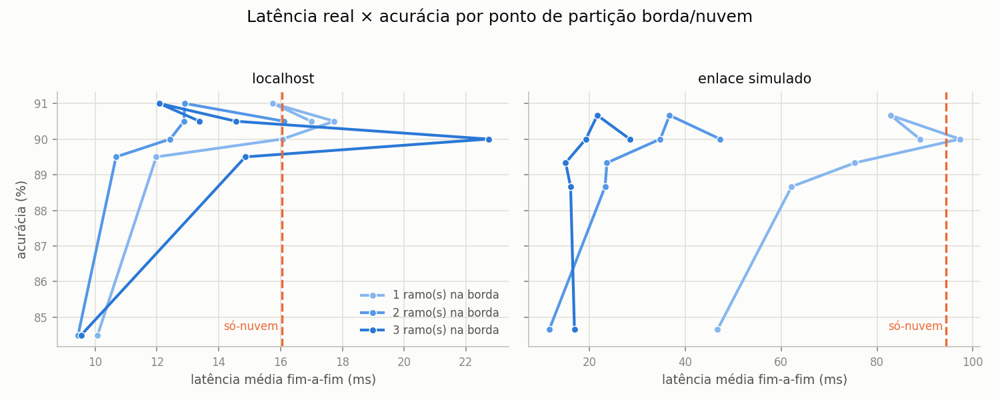

# TCC — DNN com Saídas Antecipadas para Inferência Híbrida Edge/Cloud

MobileNetV2 com **saídas antecipadas (early exits)** treinada em **CIFAR-10**, avaliada
em uma **cascata edge→cloud**: cada amostra é classificada no ramo mais raso cuja
confiança atinge um limiar `p_tar`; amostras em que nenhum ramo é confiante o
suficiente são encaminhadas à saída final (a "nuvem"). O objetivo é maximizar a
acurácia por unidade de computação gasta.

```
imagem ─► [stage 1] ─► ramo 1 ─ conf ≥ p_tar? ─ sim ─► classe   ┐
              │                     não                          │ borda (edge)
              ▼                                                  │
          [stage 2] ─► ramo 2 ─ conf ≥ p_tar? ─ sim ─► classe   ┘
              │                     não
              ▼
          [stage final] ─► saída final ─► classe                 ─ nuvem (cloud)
```

### Em uma tela

| | |
|---|---|
| **91.5%** a **16.2 M MACs** | melhor cascata na arquitetura padrão (b3 `linspace`), contra 26.6 M do modelo completo — **39% menos computação** |
| **93.0%** com a variante v3b | +1.64 pp (p < 0.0001), o resultado mais forte; custa 3.2× mais — o teto de ~91.5% é **arquitetural**, não de treino |
| **19.2 ms** contra **94.4 ms** | latência real sob enlace de 10 Mbps/50 ms, mesma acurácia: **4,9× mais rápido**, 91% das amostras resolvidas na borda |
| **6 de 27** comparações | sobreviveram ao teste pareado de McNemar — calibração e nº de ramos acima de 3 **não** produzem ganho detectável ([§7](#7-consolidação-estatística)) |

> Todos os resultados são da geração **v4** (10/08/2026), com o pipeline corrigido
> descrito em [§2](#2-dados-e-treinamento). Gerações anteriores foram descartadas
> por um defeito no warmup ([§10](#10-histórico-e-correções)); CSVs antigos em
> `results/legacy_prev4/`.

---

## 1. Modelo

| Parâmetro | Valor |
|---|---|
| Backbone | **MobileNetV2** (`torchvision`), pesos pré-treinados **ImageNet** (`IMAGENET1K_V1`) |
| Nº de ramos antecipados | **2 a 5** (paramétrico, `N_BRANCHES`) |
| Posicionamento dos ramos | Linear em **FLOPs cumulativos** (perfilados com `thop`) |
| Classes | 10 (CIFAR-10) |
| Entrada | 32×32×3 |

### Adaptação para CIFAR-10 (32×32)

A MobileNetV2 é desenhada para entradas 224×224. Para não destruir a resolução
espacial de imagens 32×32, o **primeiro conv tem o stride reduzido de 2 para 1**
(`3×3, padding=1`); esse conv perde os pesos pré-treinados (é reinicializado),
mas todas as demais camadas mantêm os pesos ImageNet.

Essa adaptação mínima deixa o mapa de features final em **2×2** (contra 7×7 no
modelo original) — os cinco últimos blocos operam sobre 4 pixels. A
[ablation de arquitetura](#6-ablation-arquitetura--seleção-de-checkpoint)
mostra que esse é o fator que limita o teto de acurácia.

### Arquitetura das saídas

Cada ramo antecipado é um classificador leve acoplado à saída de um bloco
intermediário:

```
AdaptiveAvgPool2d(1×1) → Flatten → Linear(C → 128) → ReLU → Dropout(0.5) → Linear(128 → 10)
```

`C` é inferido automaticamente via dummy forward. A saída final usa o pooling
global padrão seguido de `Dropout(0.2) → Linear(1280 → 10)` — o dropout mantém a
simetria de regularização com os ramos, sem a qual a saída final seria a única
cabeça não regularizada (o que enviesaria o estudo de calibração).

### Posicionamento por FLOPs

Os FLOPs de cada bloco de `features[]` são medidos com `thop.profile` e
acumulados; os N ramos vão nos blocos que primeiro atingem as frações
`i/(N+1)` do custo total — espaçados por **esforço computacional**, não por
contagem de camadas.

| Modelo | Posições dos ramos | MACs acumulados por saída (M) |
|---|---|---|
| b2 | 5, 13 | 9.8 / 19.2 / 26.6 |
| b3 | 3, 10, 14 | 7.4 / 14.2 / 20.5 / 26.6 |
| b4 | 3, 6, 12, 15 | 7.4 / 10.8 / 17.2 / 21.8 / 26.6 |
| b5 | 2, 5, 10, 13, 16 | 4.9 / 9.8 / 14.2 / 19.2 / 23.1 / 26.6 |

## 2. Dados e treinamento

| Hiperparâmetro | Valor |
|---|---|
| Dataset | CIFAR-10 (50k treino / 10k teste) |
| Split | 40k treino / 5k validação-seleção / 5k validação-calibração, `SEED=42` |
| Augmentation | `RandomCrop(32, pad=4)` + `RandomHorizontalFlip` (só no treino) |
| Normalização | estatísticas do ImageNet (coerente com o pré-treino) |
| Loss | Soma ponderada de `CrossEntropyLoss` sobre todas as saídas |
| Fase 1 — warmup | 5 épocas, backbone congelado; treinam os heads novos (ramos, classificador final e o 1º conv), Adam `lr=1e-3` |
| Fase 2 — fine-tuning | Rede inteira, Adam `lr=1e-4` |
| Early stopping | Paciência 30 sobre a validação-seleção, `min_delta` 1e-4 (loss) / 0.05 pp (acc), máx. 150 épocas |
| Batch size | 128 |

**Protocolo de validação.** As duas metades da validação são disjuntas e têm
papéis distintos: `val_select` faz early stopping e seleção de checkpoint,
`val_calib` ajusta as temperaturas. Sem essa separação, o mesmo conjunto
escolheria o modelo e calibraria suas probabilidades.

**Dois checkpoints por treino.** Cada run salva o melhor por **val loss** e o
melhor por **val acc** — da mesma trajetória. Isso isola o efeito do critério de
seleção da variância entre treinos (ver
[§6](#6-ablation-arquitetura--seleção-de-checkpoint)). Salvo indicação em
contrário, os resultados reportados usam o checkpoint selecionado por **val acc**,
critério que não penaliza configurações cuja val loss atinge o mínimo cedo.

### Estratégias de peso da loss

- **`equal`** — todas as saídas com peso 1.0;
- **`linspace`** — pesos crescentes de 0.15 (raso) a 1.0 (final), esquema clássico
  tipo BranchyNet;
- também suportados: `inv_linspace` e pesos manuais via CSV.

### Acurácia por saída (test set, checkpoint por val acc)

| Modelo | Estratégia | Ramo 1 | Ramo 2 | Ramo 3 | Ramo 4 | Ramo 5 | Final |
|---|---|---|---|---|---|---|---|
| b2 | equal | **81.22** | 90.43 | — | — | — | 90.15 |
| b2 | linspace | 74.96 | 90.82 | — | — | — | 90.98 |
| b3 | equal | **67.96** | 89.61 | 91.45 | — | — | 91.27 |
| b3 | linspace | 61.94 | 89.40 | 91.35 | — | — | 91.30 |
| b4 | equal | **67.78** | 84.27 | 89.57 | 90.37 | — | 90.24 |
| b4 | linspace | 61.79 | 82.23 | 90.67 | 91.17 | — | 91.04 |
| b5 | equal | **53.49** | 78.57 | 88.67 | 90.01 | 89.98 | 89.96 |
| b5 | linspace | 49.11 | 76.32 | 89.35 | 90.65 | 90.93 | 91.07 |

`equal` produz ramos rasos consistentemente melhores (+4 a +6 pp na primeira
saída); `linspace` produz saídas profundas melhores. Essa troca é o eixo do
achado nº 1 abaixo.

## 3. Calibração — Temperature Scaling

Uma temperatura `T` divide os logits antes do softmax (`softmax(z/T)`),
otimizada por **LBFGS** (init `T=1.5`, `lr=0.01`, 50 iterações) minimizando a NLL
na metade de calibração da validação (Guo et al., 2017). Duas variantes:
**`overall`** (uma `T` para todas as saídas) e **`branches`** (uma `T_i` por saída).

| Modelo | Estratégia | T per-branch (rasa → final) | T overall |
|---|---|---|---|
| b2 | equal | 1.30, 1.76, 1.80 | 1.61 |
| b2 | linspace | 1.25, 1.76, 1.80 | 1.58 |
| b3 | equal | 1.21, 1.66, 1.78, 1.78 | 1.59 |
| b3 | linspace | 1.17, 1.61, 1.79, 1.79 | 1.58 |
| b4 | equal | 1.22, 1.35, 1.73, 1.79, 1.80 | 1.57 |
| b4 | linspace | 1.15, 1.31, 1.71, 1.79, 1.80 | 1.54 |
| b5 | equal | 1.20, 1.29, 1.61, 1.76, 1.78, 1.79 | 1.58 |
| b5 | linspace | 1.19, 1.26, 1.59, 1.76, 1.79, 1.79 | 1.56 |

`T` cresce monotonicamente com a profundidade da saída em todos os modelos: as
saídas profundas são as mais *overconfident*.


O ganho da calibração é grande em `p_tar` baixo (+2.8 pp em b2 a +9.8 pp em b5,
em `p_tar`=0.50) e some perto de 0.95 — e cresce com o número de ramos, porque
mais saídas mal calibradas significam mais decisões de parada erradas. Esse ganho
some por completo quando cada configuração pode reescolher seu limiar
([§7](#7-consolidação-estatística)).

## 4. Protocolo de avaliação (cascata)

- **Test set completo** (10k amostras), logits de todas as saídas coletados uma vez.
- **`p_tar` de 0.50 a 0.95 em passos de 0.05, mais 0.96–0.99** (14 pontos) ×
  **3 modos de calibração** (`none`, `overall`, `branches`). A cauda fina é
  necessária porque modelos com ramo raso muito forte saturam: sem ela, a curva
  da v3b ocuparia quase um único ponto.
- Avaliado em **test e validação**: o `p_tar` reportado é escolhido na validação
  (ver [§7](#7-consolidação-estatística)).
- A amostra sai na **primeira saída com confiança ≥ `p_tar`**; senão, na final.
- **Variância**: meia-largura do **IC95% binomial** (`1.96·√(p(1−p)/n)`).
- **Custo médio**: `E[MACs] = Σ frac_i · MACs_acum_i` (colunas `macs_mean_M`,
  `macs_rel_%`). É a métrica honesta do trade-off — "% na borda" sozinho
  superestima o ganho, pois um ramo profundo conta como "borda" custando quase a
  rede inteira.

## 5. Resultados


Cada curva é um modelo; cada ponto, um `p_tar`. **Subir e ir para a esquerda é
melhor.** As curvas de b3–b5 ficam à esquerda de b2 na mesma altura: mais ramos
compram o mesmo acerto por menos computação. O joelho fica em ~16 M MACs — daí em
diante, gastar mais não compra acurácia.

**No ponto de operação `p_tar` = 0.90** (calibração `overall`, checkpoint por val acc):

| Modelo | Acurácia | MACs médios | % do modelo completo | Vai à nuvem |
|---|---|---|---|---|
| b2 `equal` | 90.28 ± 0.58 | 17.4 M | 65% | 13.8% |
| b2 `linspace` | 91.07 ± 0.56 | 18.9 M | 71% | 13.0% |
| b3 `equal` | 91.19 ± 0.56 | 15.8 M | 59% | 9.1% |
| **b3 `linspace`** | **91.47 ± 0.55** | **16.2 M** | **61%** | 9.4% |
| b4 `equal` | 90.27 ± 0.58 | 15.6 M | 59% | 9.7% |
| b4 `linspace` | 91.09 ± 0.56 | 16.1 M | 61% | 8.2% |
| b5 `equal` | 90.05 ± 0.59 | 15.2 M | 57% | 9.0% |
| b5 `linspace` | 91.01 ± 0.56 | 15.4 M | 58% | 7.9% |

O modelo completo custa 26.6 M MACs e acerta 91.3%. A cascata iguala esse acerto
gastando ~60% disso.

### O limiar controla o trade-off

| | |
|---|---|
|  |  |

**Esquerda:** a acurácia satura a partir de `p_tar` ≈ 0.85 — apertar mais o limiar
só empurra amostras para a nuvem sem acertar mais. **Direita:** a fração resolvida
na borda cai monotonicamente com o limiar; é a mesma decisão vista pelo lado do
custo. As duas figuras juntas dizem onde parar: o joelho da esquerda é o `p_tar`
que se deve usar.

### `equal` e `linspace` produzem cascatas diferentes


Cada barra mostra em qual saída as amostras foram resolvidas. `equal` concentra
muito mais tráfego no primeiro ramo (38.4% em b2/`p_tar`=0.85 contra 20.4% de
`linspace`), porque treina os ramos rasos com peso total. `linspace` termina com
acurácia global maior, mas com uma cascata que quase não usa as saídas rasas —
exatamente a troca discutida no [achado 1](#9-principais-achados).

### Reliability diagrams e ECE


Pontos abaixo da diagonal = excesso de confiança; acima = falta de confiança.

ECE (%) por saída, `equal`, checkpoint por val acc:

| Modelo | Calib | Ramo 1 | Ramo 2 | Ramo 3 | Ramo 4 | Ramo 5 | Final |
|---|---|---|---|---|---|---|---|
| b3 | none | **1.5** | 6.4 | 6.3 | — | — | 6.4 |
| b3 | overall | 13.5 | **3.7** | 4.8 | — | — | 4.8 |
| b3 | branches | 5.4 | 3.3 | **4.2** | — | — | **4.3** |
| b5 | none | **1.3** | **1.5** | 6.3 | 7.0 | 7.4 | 7.5 |
| b5 | overall | 13.0 | 9.8 | **2.7** | 5.1 | 5.7 | 5.7 |
| b5 | branches | 5.5 | 4.5 | 2.5 | **4.4** | **5.0** | **5.0** |

Os ramos rasos já nascem calibrados (ECE 1.3–1.5%) e a temperatura única os
**piora** (13%): ela é dimensionada pelas saídas profundas, que são
overconfident. `branches` corrige isso, mas sem ganho de acurácia
([§7](#7-consolidação-estatística)).

## 6. Ablation: arquitetura × seleção de checkpoint

Duas variantes zeram strides internos (`EXTRA_STRIDE1`) para aumentar o mapa de
features: **v3a** (`features[14]`, mapa 4×4, backbone 46.3 M MACs) e **v3b**
(`features[7]`+`[14]`, 8×8, 151.6 M). Cada arquitetura foi avaliada com os dois
checkpoints da **mesma trajetória** (b3, `equal`, calibração `overall`):

| Arquitetura | Final (teste), sel. loss | Final, sel. acc | Melhor cascata (acc) | MACs no ponto |
|---|---|---|---|---|
| padrão (2×2) | 90.89 | 91.27 | 91.33 ± 0.55 | 16.6 M |
| v3a (4×4) | 90.82 | 91.15 | 91.27 ± 0.55 | 16.6 M |
| v3b (8×8) | 91.96 | **93.01** | **92.98 ± 0.50** | 53.4 M |


- **v3b eleva o teto em +1.65 pp** (92.98 vs 91.33; ICs sem sobreposição), a 3.2×
  o custo. Confirma que o teto de ~91% é arquitetural, não de otimização.
- **v3a empata com o padrão ao mesmo custo** — o mapa 4×4 não compensa.
- O primeiro ramo da v3b atinge **92.00%** sozinho (42.8 M MACs), acima de
  qualquer modelo da arquitetura padrão. Consequência: a cascata resolve quase
  tudo na primeira saída, e o early-exit perde função — quando o ramo raso é forte
  demais, o sistema degenera em um modelo único.

### O critério de seleção de checkpoint importa

Comparando os dois checkpoints de cada trajetória (Δ na saída final, teste):

| Config | Δ (acc − loss) | Época escolhida por loss | por acc |
|---|---|---|---|
| b2 equal | 0.00 | 150 | 150 |
| b3 equal | +0.38 | 93 | 141 |
| b4 equal | −0.08 | 146 | 147 |
| b5 equal | +0.11 | 138 | 144 |
| b2 linspace | **+1.09** | 28 | 148 |
| b3 linspace | +0.66 | 48 | 142 |
| b4 linspace | **+0.92** | 30 | 142 |
| b5 linspace | +0.15 | — | 149 |
| v3b | **+1.05** | 19 | 90 |

O efeito **não** escala com a capacidade do modelo: ele acompanha **quão cedo a
val loss atinge o mínimo**. Configurações cuja NLL de validação degrada logo
(linspace, v3b: épocas 19–48) são interrompidas com o modelo ainda subtreinado,
enquanto a acurácia continuaria subindo por mais 100 épocas — o mecanismo de
*NLL overfitting* de Guo et al. aparecendo como viés de **seleção de modelo**.

## 7. Consolidação estatística

Duas correções de protocolo sobre a leitura direta das tabelas acima
([src/stats.py](src/stats.py)):

1. **`p_tar` escolhido na validação.** Ler o melhor ponto de operação no test
   set, entre 14 limiares × 3 calibrações × 20 modelos, é *data snooping*. Aqui o
   limiar é escolhido maximizando a acurácia em `val_select` e o teste é
   reportado só nesse ponto. Os ótimos migram para `p_tar` 0.95–0.99 e as
   acurácias caem 0.1–0.4 pp em relação ao número lido no teste.
2. **McNemar exato pareado** no lugar de comparar IC95%. Os modelos classificam
   as mesmas 10k amostras: as concordâncias não informam nada sobre qual é
   melhor, e o teste olha apenas o desequilíbrio entre as discordâncias. É bem
   mais sensível que comparar intervalos, que tratam as medidas como
   independentes.


**6 de 27 comparações sobrevivem.** Sobrevivem: a vantagem arquitetural da v3b, a
de `linspace` em 3 dos 4 tamanhos, o ganho de b3 sobre b2, e o efeito do critério
de seleção **onde a val loss atinge o mínimo cedo**. Não sobrevivem: `overall` vs
`branches`, o ganho de calibração no ponto ótimo, a v3a, e o efeito de seleção
nos modelos `equal`.

Os dois blocos inferiores da figura merecem atenção: as barras de calibração são
**curtas e centradas no zero** — não é "efeito pequeno mas real", é ausência de
efeito com incerteza estreita o bastante para descartá-lo. Já as barras não
significativas dos blocos superiores (b4, b5 vs b2) são **largas**: ali a
conclusão é "não dá para saber", não "são iguais".

Dados completos em `results/stats_comparisons.csv`.

## 8. Latência real (borda/nuvem)

As seções acima medem **custo teórico** (MACs); esta mede **tempo real**. Os dois
nós rodam como serviços HTTP separados ([src/serving/](src/serving/)): a borda
executa os `nr_branch_edge` primeiros ramos e, se nenhum atingir `p_tar`, envia o
**mapa de features intermediário** para a nuvem terminar a inferência. O mapa vai
como bytes de `.npy` em float16 — lista JSON infla o payload ~10× e distorceria a
própria grandeza medida. Como os dois nós dividem o host, o enlace é simulado por
atraso proporcional ao payload (`LINK_MBPS`, `LINK_RTT_MS`).

Modelo b3 `equal` (val acc), calibração `overall`, 150 imagens por ponto após
aquecimento, enlace de **10 Mbps com RTT de 50 ms**:

| Ramos na borda | `p_tar` | Latência total | borda | rede | nuvem | Resolvido na borda | Acurácia | Payload |
|---|---|---|---|---|---|---|---|---|
| 1 | 0.90 | 97.3 ms | 12.7 | 57.5 | 18.2 | 4% | 90.0% | 11.9 KB |
| 2 | 0.90 | 34.8 ms | 17.0 | 10.4 | 2.9 | 80% | 90.0% | 435 B |
| **3** | **0.90** | **19.2 ms** | 12.6 | 4.8 | 0.5 | 91% | 90.0% | 131 B |
| 3 | 0.95 | 21.6 ms | 12.2 | 7.2 | 0.8 | 86% | 90.7% | 197 B |
| — | — | **94.4 ms** | — | — | 13.7 | 0% (só-nuvem) | 90.0% | 2.2 KB |



**Particionar cedo é pior que não particionar.** O mapa de features após o
primeiro ramo ocupa 12.4 KB — 5,5× a imagem PNG (2.2 KB) — e enviá-lo custa 97 ms,
*acima* do baseline só-nuvem. O payload só encolhe em partições profundas (131 B
após o terceiro ramo), onde a rede já comprimiu o tensor.

**No ponto certo, 19.2 ms contra 94.4 ms — 4,9× com a mesma acurácia.** Em
`localhost` o baseline cai para 16.1 ms e a vantagem encolhe para 1,7×: o ganho
do early-exit é dominado pela **comunicação evitada**, não pela computação.

**Limitações:** borda e nuvem no mesmo host e na mesma GPU (competem por
recurso), enlace simulado por `sleep`, 150 imagens por ponto, só b3 medido.

## 9. Principais achados

| # | Achado | Evidência | Veredito |
|---|---|---|---|
| 1 | O peso da loss é uma escolha de **objetivo**, não de qualidade: `linspace` dá mais acurácia, `equal` dá mais offload | +0.79 a +1.06 pp em b2/b4/b5 (empata em b3); mas `equal` resolve 38.4% no 1º ramo contra 20.4% | p ≤ 0.006 |
| 2 | O **teto é arquitetural**: nenhuma receita de treino passou de ~91.5% com mapa 2×2; ampliá-lo para 8×8 leva a 93.0% | +1.64 pp (v3b vs padrão), a 3.2× o custo. A variante 4×4 não compensa (p = 0.67) | p < 0.0001 |
| 3 | **Mais ramos compram eficiência, não acurácia** — e não linearmente | b3 supera b2 em +1.14 pp; b4 e b5 empatam com b2. O que ganham é custo: 17.4 → 15.2 M MACs no mesmo limiar | p = 0.0001 |
| 4 | O **critério de seleção de checkpoint** só importa quando a val loss funda cedo | +0.77 a +1.03 pp em `linspace` e v3b (NLL degrada nas épocas 19–48); nada nos `equal`, que só oscilam num platô | p ≤ 0.003 |
| 5 | **A calibração ajuda quem opera com limiar fixo, não quem pode ajustá-lo** | Em `p_tar`=0.50 o ganho vai de +2.8 a +9.8 pp; quando cada configuração reescolhe o limiar, **desaparece** | p = 0.13–1.00 (**não** sig.) |
| 6 | **Melhor calibração ≠ melhor cascata**: `overall` e `branches` são indistinguíveis | `branches` tem os menores ECEs, mas as duas discordam em só 2 a 38 das 10k amostras | p = 0.23–1.00 (**não** sig.) |
| 7 | **O ganho real vem da comunicação evitada, não da computação** | 4,9× sob enlace de 10 Mbps/50 ms contra 1,7× em localhost | medido, [§8](#8-latência-real-bordanuvem) |
| 8 | **Particionar cedo é contraproducente**: o mapa de features após o 1º ramo é 5,5× maior que a imagem | 12.4 KB vs 2.2 KB → essa configuração fica mais lenta que mandar tudo à nuvem | medido, [§8](#8-latência-real-bordanuvem) |

Dois pontos de leitura que evitam conclusões erradas:

- **A acurácia da nuvem parece baixa (40–60%) por viés de seleção** — ela recebe
  só as amostras que nenhum ramo resolveu, as intrinsecamente difíceis.
- **A temperatura única sobrecorrige os ramos rasos.** Eles já nascem calibrados
  (ECE 1.3–1.5%) e a `T` dimensionada pelas saídas profundas os leva a 13% de
  ECE, agora por subconfiança. Na v3b o padrão se inverte: o ramo raso dela é
  overconfident (5.0%) e a `T` única o melhora (2.4%).

## 10. Histórico e correções

Três gerações de experimentos precederam a atual; os resultados de todas foram
descartados:

- **v1** (Adam) — validação com augmentation e normalização incorreta.
- **v2** (SGD + cosine + LR por grupo) — regressão de 2 a 3.5 pp: a receita de
  treino *from scratch* de CIFAR destrói as features pré-treinadas do ImageNet.
- **v3** — ablation de arquitetura, mas com o defeito do warmup abaixo.
- **v4** (atual) — corrige:
  1. `freeze_backbone()` congelava o **classificador final**, uma cabeça
     recém-inicializada: ela ficava presa em ~11% (acaso) durante as 5 épocas de
     warmup, e sua loss retropropagava ruído para o primeiro conv;
  2. ausência de dropout na saída final (única cabeça sem regularização);
  3. checkpoint único por run (impossibilitava atribuir o efeito do critério de
     seleção);
  4. uso triplo da validação (early stopping + seleção + calibração);
  5. ausência de `min_delta` (early stopping nunca disparava com seleção por acc).

Achados que **não** sobreviveram ao pipeline corrigido: "`equal` vence em todos
os `p_tar`" (era artefato da seleção por val loss, que interrompia `linspace`
prematuramente) e "v3a é um upgrade grátis" (era comparação contra baseline
prejudicado).

## 11. Estrutura do repositório

```
src/
  model.py       # MobileNetV2EarlyExit paramétrico, posicionamento por FLOPs,
                 #   profiling de MACs por saída, variantes de stride (v3)
  data.py        # datasets, split treino/val-seleção/val-calibração, normalização
  train.py       # treino em 2 fases, multi-estratégia, duplo checkpoint
  calibrate.py   # temperature scaling (overall + per-branch), LBFGS
  inference.py   # cascata edge→cloud: p_tar × calibração → CSVs
  plots.py       # figuras a partir dos CSVs
  reliability.py # reliability diagrams + ECE por saída
  stats.py       # p_tar escolhido na validação + McNemar pareado
  serving/       # servidores Flask de borda e nuvem + cliente de latência
saved_model/     # checkpoints (pesos + posições + temperaturas + metadados)
results/         # CSVs da cascata; stats_comparisons.csv = as 27 comparações
                 #   pareadas; legacy_prev4/ = gerações anteriores; latency/ = tempo real
plots/ logs/ data/ fontes/
run_retrain_v4.sh   # pipeline completo não supervisionado
run_experiments.sh  # grade b2-b5 apenas
```

## 12. Como reproduzir

Requer [uv](https://docs.astral.sh/uv/) e, idealmente, uma GPU CUDA.

```bash
uv sync && uv pip install -r requirements.txt

# tudo (grade + variantes + figuras), ~11h:
./run_retrain_v4.sh

# ou por etapa:
N_BRANCHES=3 LOSS_WEIGHTS_LIST=equal uv run python -m src.train
N_BRANCHES=3 uv run python -m src.calibrate      # VARIANT=acc p/ o outro checkpoint
N_BRANCHES=3 uv run python -m src.inference
uv run python -m src.plots
uv run python -m src.reliability
uv run python -m src.stats        # requer results/preds/*.npz da inferência

# latência real (3 terminais, ou nohup):
CHECKPOINT=saved_model/mobilenet_acc_b3_equal_best.pth uv run python -m src.serving.cloud
CHECKPOINT=saved_model/mobilenet_acc_b3_equal_best.pth LINK_MBPS=10 LINK_RTT_MS=50 \
    uv run python -m src.serving.edge
uv run python -m src.serving.client

# variantes de arquitetura:
#   EXTRA_STRIDE1=14    → mapa 4×4 (v3a)
#   EXTRA_STRIDE1=7,14  → mapa 8×8 (v3b)
```

## Referências principais

- Teerapittayanon et al., *BranchyNet: Fast Inference via Early Exiting from Deep Neural Networks* (2016)
- Guo et al., *On Calibration of Modern Neural Networks* (2017)
- Sandler et al., *MobileNetV2: Inverted Residuals and Linear Bottlenecks* (2018)
- PDFs em [fontes/](fontes/)
